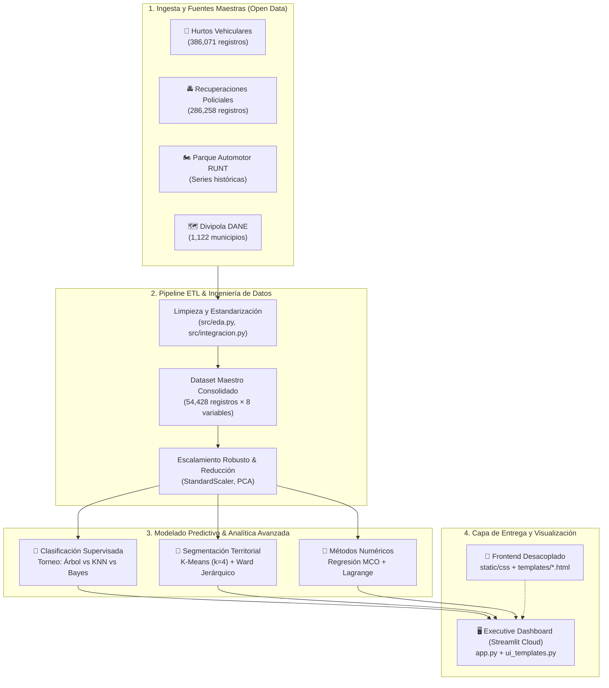

# 🛡️ Observatorio de Inteligencia y Minería de Datos: Hurto Vehicular y Capacidad de Recuperación Policial en Colombia

<div align="center">

[](https://read-hurtos-tolimagit-5wkeks9sja6k7i6zfjhecr.streamlit.app/)


**Investigación Aplicada de Minería de Datos, Aprendizaje Automático y Métodos Numéricos**  
*Corporación Universitaria Minuto de Dios — UNIMINUTO Sede Ibagué · 2026-2*

[🚀 Abrir Aplicación Web en Vivo](https://read-hurtos-tolimagit-5wkeks9sja6k7i6zfjhecr.streamlit.app/) · [📑 Documentación Técnica](docs/DOCUMENTACION_TECNICA.md) · [🎤 Pitch y Sustentación](docs/PITCH_Y_SUSTENTACION_OFICIAL.md) · [📐 Métodos Numéricos](docs/metodos_numericos/presentacion_metodos_numericos.html)

</div>

---

## 📌 Contexto Estratégico y Planteamiento del Problema

El hurto de automotores y motocicletas constituye uno de los fenómenos delictivos con mayor impacto económico, social y en la percepción de seguridad ciudadana en Colombia. Tradicionalmente, la asignación de recursos policiales se ha ejecutado de manera reactiva e intuitiva, careciendo de herramientas analíticas predictivas que anticipen la incidencia criminal a partir de la escala del parque automotor territorial.

Este proyecto aplica la metodología **CRISP-DM** (*Cross-Industry Standard Process for Data Mining*) sobre un consolidado histórico oficial de **54,428 observaciones municipales**, integrando tres fuentes maestras del Estado colombiano:
1. **Denuncias de Hurto de Automotores y Motocicletas** (Policía Nacional / DIJIN / Datos Abiertos Colombia).
2. **Operaciones de Recuperación Vehicular Efectiva** (Policía Nacional / DIJIN).
3. **Crecimiento Histórico del Parque Automotor** (Registro Único Nacional de Tránsito — RUNT).
4. **Codificación Político-Administrativa Municipal** (DANE / DIVIPOLA).

### 🎯 Pregunta de Investigación Central
> *¿De qué manera la tipología vehicular y la escala del parque automotor registrado en los municipios colombianos condicionan la incidencia del hurto, y cuál es la efectividad real de la capacidad policial de recuperación frente a la hiperconcentración del delito en áreas metropolitanas?*

---

## 🏛️ Arquitectura del Sistema y Flujo de Procesamiento

El sistema implementa una arquitectura modular desacoplada basada en micro-etapas, separando estrictamente la ingesta de datos, los modelos analíticos y la capa de presentación web:



---

## 📂 Estructura del Repositorio

La organización del proyecto sigue las mejores prácticas de la ingeniería de software y ciencia de datos profesional:

```text
read-hurtos-Tolima/
├── .github/
│   └── workflows/
│       └── python-tests.yml        # Pipeline CI para validación sintáctica automática
├── app.py                          # Entrypoint principal de la plataforma web en Streamlit
├── ui_templates.py                 # Motor desacoplado de renderizado de plantillas HTML y CSS
├── requirements.txt                # Dependencias fijadas y reproducibles para producción
├── Dockerfile                      # Imagen Docker contenerizada multiplataforma
├── .gitignore                      # Exclusiones optimizadas para entornos Python y Jupyter
├── README.md                       # Documento ejecutivo principal del proyecto
│
├── static/                         # Activos web estáticos
│   └── css/
│       └── styles.css              # Hoja de estilos centralizada (Glassmorphism & Clean UI)
│
├── templates/                      # Componentes visuales desacoplados en HTML puro
│   ├── hero_banner.html            # Cabecera ejecutiva con metadatos institucionales
│   ├── context_box.html            # Ficha de contextualización académica del problema
│   ├── kpi_card.html               # Tarjetas métricas ejecutivas
│   ├── model_card.html             # Tarjetas comparativas del torneo de modelos
│   ├── cluster_kpi.html            # Fichas tácticas de caracterización de clústeres
│   ├── alert_card.html             # Dictámenes interactivos del simulador en vivo
│   ├── sidebar_authors.html        # Panel de autoría institucional
│   └── presentacion_metodos_numericos.html # Sustentación matemática (MathJax & Canvas)
│
├── dataset/                        # Almacenamiento local de datasets procesados
│   ├── dataset_integrado.csv       # Dataset consolidado de 54,428 observaciones
│   ├── dataset_con_clusters.csv    # Dataset enriquecido con etiquetas de clústeres
│   ├── HurtoVehiculos_limpio.csv
│   ├── RecuperacionPoliciaNacional_limpio.csv
│   └── CrecimientoParqueAutomotor_limpio.csv
│
├── src/                            # Lógica de negocio y pipelines reutilizables en Python
│   ├── __init__.py                 # Inicializador seguro para entornos cloud
│   ├── eda.py                      # Clase de Análisis Exploratorio de Datos
│   ├── integracion.py              # Clase de integración relacional y cruce territorial
│   ├── transformacion.py           # Pipeline de escalamiento, PCA y variables derivadas
│   ├── clasificacion.py            # Clase de modelos supervisados (Árbol, KNN, Naive Bayes)
│   ├── clasificacion_sesion8.py    # Benchmark comparativo de clasificación supervisada
│   ├── clustering.py               # Algoritmos no supervisados K-Means y Jerárquico
│   ├── hurto.py                    # Procesamiento y estandarización de hurtos
│   ├── recuperacion.py             # Procesamiento de recuperaciones policiales
│   └── parque_automotor.py         # Procesamiento de parque automotor RUNT
│
├── notebooks/                      # Cuadernos Jupyter reproducibles organizados por etapas
│   ├── 01_eda_exploratorio.ipynb
│   ├── 02_transformacion_y_escalabilidad.ipynb
│   ├── 03_sesion8_clasificacion_supervisada.ipynb
│   ├── 04_sesion9_clustering_territorial.ipynb
│   └── exploratorios/              # Cuadernos prototipo y de experimentación previa
│       ├── analisis_datos.ipynb
│       ├── clustering_v1.ipynb
│       └── modelos_v1.ipynb
│
├── docs/                           # Hub de documentación técnica, académica y sustentación
│   ├── DOCUMENTACION_TECNICA.md
│   ├── PITCH_Y_SUSTENTACION_OFICIAL.md
│   ├── SUSTENTACION_AUDITORIO.md
│   ├── informes/                   # Informes metodológicos por sesión
│   │   ├── INFORME_LABORATORIO_EDA.md
│   │   ├── TORNEO_CLASIFICACION_SESION8.md
│   │   └── SEGMENTACION_CLUSTERING_SESION9.md
│   ├── metodos_numericos/          # Módulo de Regresión MCO e Interpolación de Lagrange
│   │   └── presentacion_metodos_numericos.html
│   ├── presentaciones/             # Diapositivas en formato PPTX
│   │   └── Hurto_y_Recuperacion_Vehiculos_Colombia.pptx
│   └── figuras/                    # Galería de figuras analíticas en alta resolución
│
└── scripts/                        # Scripts de automatización y despliegue
    ├── run_dashboard.sh            # Script bash para lanzamiento local
    ├── startup.sh                  # Entrypoint de configuración para nubes PaaS
    ├── generar_figuras_sesion8.py
    └── generar_figuras_sesion9.py
```

---

## 🏆 Hallazgos Analíticos y Rendimiento de Modelos

### 1. Torneo de Clasificación Supervisada (Sesión 8)
Se formuló el problema de clasificación binaria: predecir si una combinación municipal-vehicular presentará **Hurto Activo** ($Y=1$) o **Incidencia Nula** ($Y=0$).

| Modelo Algorítmico | Exactitud (Accuracy) | Sensibilidad (Recall) | F1-Score | Veredicto Técnico |
| :--- | :---: | :---: | :---: | :--- |
| **Árbol de Decisión (CART)** | **99.98%** | **99.94%** | **0.999** | 🥇 **Campeón Absoluto:** Reglas de umbral exactas e interpretabilidad total. |
| **K-Nearest Neighbors ($k=5$)** | **99.82%** | **99.49%** | **0.997** | 🥈 **Subcampeón:** Alta coherencia geométrica en el espacio de características. |
| **Gaussian Naïve Bayes** | **96.07%** | **84.81%** | **0.900** | 🥉 **Línea Base:** Penalizado por el supuesto de independencia condicional. |

### 2. Segmentación Territorial No Supervisada (Sesión 9)
Mediante **K-Means ($k=4$)** validado por el **Método del Codo** y **Coeficiente de Silueta**, cruzado con **Dendrograma Jerárquico (Ward)**:
* **Clúster 0 · Foco Crítico (0.13% - Bogotá / Medellín / Cali):** Hiperconcentración masiva de hurtos (promedio $>2,800$ casos) donde la capacidad de recuperación policial queda colapsada.
* **Clúster 1 · Municipios de Incidencia Media-Alta (1.2% - Ibagué, Bucaramanga, etc.):** Capitales intermedias con parque automotor en rápida expansión y presión criminal creciente.
* **Clúster 2 · Municipios Intermedios con Delincuencia Moderada (5.4%):** Cabeceras provinciales con incidentes esporádicos controlables.
* **Clúster 3 · Ruralidad y Delincuencia Marginal (93.3%):** Municipios pequeños con incidencia delictiva prácticamente nula.

### 3. Métodos Numéricos Integrados
* **Regresión Lineal Simple por Mínimos Cuadrados Ordinarios (MCO):** Modela la relación funcional entre el volumen de hurtos y las recuperaciones policiales esperadas.
* **Interpolación Polinómica de Lagrange:** Reconstruye la curva exacta del comportamiento delictivo en puntos históricos específicos para interpolar ventanas de tiempo intermedias.

---

## 🚀 Instalación y Ejecución Local

### Prerrequisitos
* Python 3.10 o superior (recomendado Python 3.11).
* Git.

### Paso 1: Clonar el repositorio
```bash
git clone https://github.com/pavaarcecamila-lab/read-hurtos-Tolima.git
cd read-hurtos-Tolima
```

### Paso 2: Crear y activar entorno virtual
```bash
# macOS / Linux
python3 -m venv .venv
source .venv/bin/activate

# Windows
python -m venv .venv
.venv\Scripts\activate
```

### Paso 3: Instalar dependencias
```bash
pip install --upgrade pip
pip install -r requirements.txt
```

### Paso 4: Ejecutar la aplicación web
```bash
streamlit run app.py
```
La aplicación se abrirá automáticamente en tu navegador en `http://localhost:8501`.

---

## 🐳 Despliegue con Docker

El repositorio incluye un `Dockerfile` optimizado y listo para producción:

```bash
# Construir la imagen
docker build -t observatorio-hurtos-tolima .

# Ejecutar el contenedor
docker run -p 8501:8501 observatorio-hurtos-tolima
```

---

## 👥 Equipo de Investigación y Créditos Académicos

* **Investigadoras / Autoras:**
  * **Natalia Valencia** — *UNIMINUTO Sede Ibagué*
  * **Camila Pava** — *UNIMINUTO Sede Ibagué*
* **Docente Asesor:**
  * **Esteban Ernesto Morales Castro** — *Docente de Minería de Datos*
* **Institución:**
  * **Corporación Universitaria Minuto de Dios — UNIMINUTO**
  * *Facultad de Ingeniería · Programa de Ingeniería de Sistemas*
  * *Ibagué, Tolima, Colombia · 2026-2*
