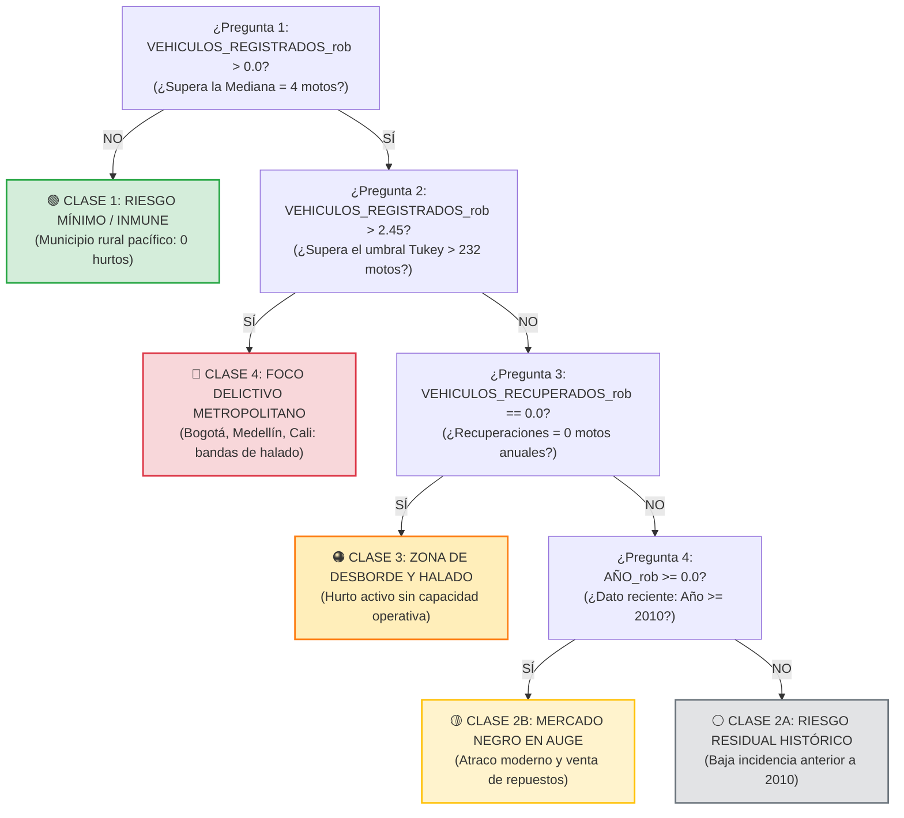
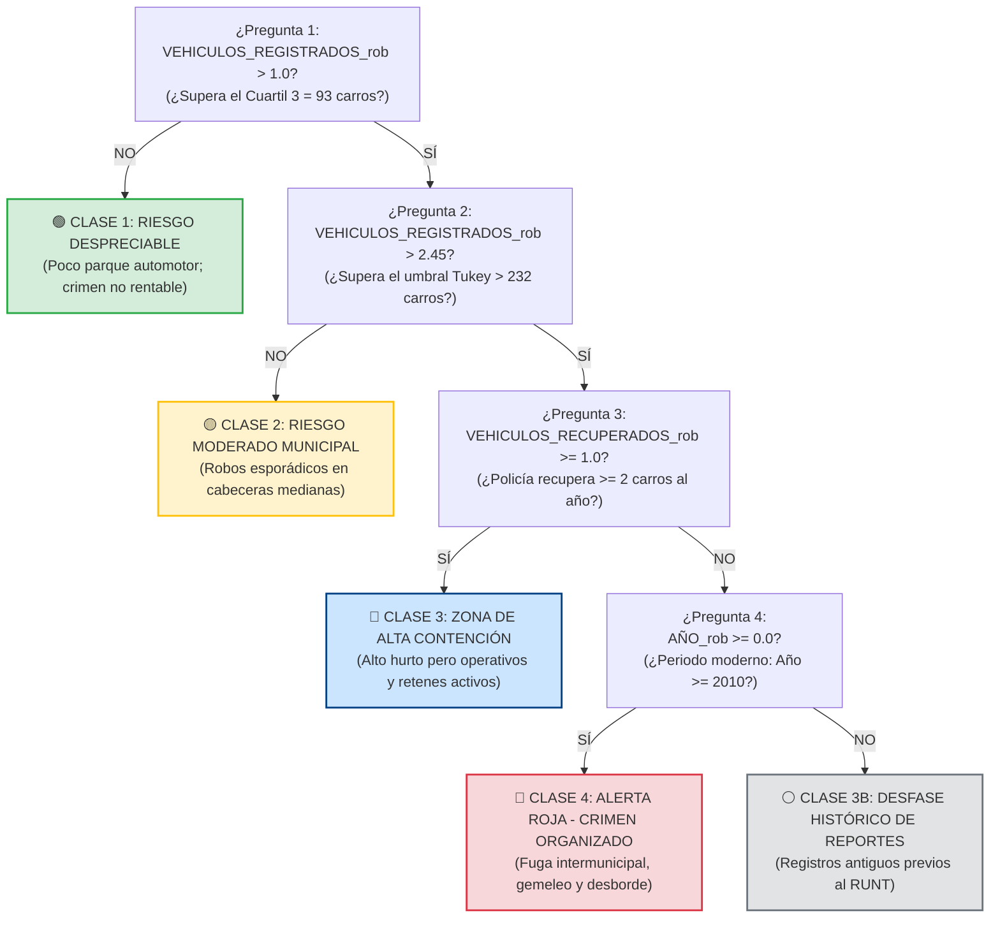

# ÁRBOLES DE DECISIÓN Y MÉTRICAS DE ACCURACY
## Proyecto: Análisis del Hurto de Vehículos y Capacidad Policial en Colombia
**Docente:** Esteban Ernesto Morales Castro · UNIMINUTO Sede Ibagué · 2026-2

---

> 🎯 **PROPÓSITO DE ESTE DOCUMENTO:**  
> Este archivo resume en un solo lugar los **dos árboles de decisión oficiales de tu presentación** (Motocicletas vs Carros) con sus diagramas de flujo completos, sus 4 preguntas de Sí/No, sus clases de riesgo y las **métricas oficiales de Accuracy (Entrenamiento y Prueba)** para sustentar ante el profesor.

---

# PARTE 1 · ¿POR QUÉ DOS ÁRBOLES SEPARADOS? (EL FUNDAMENTO)

El Análisis Exploratorio de Datos (EDA) demostró que **la motocicleta y el carro representan dos fenómenos criminales opuestos** que no se pueden evaluar con la misma regla:

| Criterio | Árbol 1: Motocicletas (`MOTOCICLETA`) | Árbol 2: Automotores (`AUTOMOTOR`) |
| :--- | :--- | :--- |
| **Volumen Nacional** | **$75,7\%$ del total de hurtos** ($291.905$ casos). | **$24,3\%$ del total** ($93.589$ casos). |
| **Tasa de Victimización** | **$23$ hurtos** por cada $1.000$ motos registradas. | **$15$ hurtos** por cada $1.000$ carros registrados. |
| **Recuperación Policial** | **Baja ($41,3\%$)** $\rightarrow$ Desguace rápido para autopartes. | **Alta ($60,6\%$)** $\rightarrow$ Retenes viales y aseguradoras. |
| **Modalidad Delictiva** | Delincuencia común, halado y descuido en vía pública. | Crimen organizado, atraco a mano armada, gemeleo y GPS jammers. |
| **Filtro de Entrada (P1)** | Muy sensible: desde la **Mediana ($4$ motos)**. | Exige masa crítica: desde el **Cuartil 3 ($93$ carros)**. |

---

# PARTE 2 · ÁRBOL 1: SEGMENTO MOTOCICLETAS
> **Contexto:** Concentran más del $75\%$ de los hurtos. Delito de oportunidad con alta tasa de victimización y baja recuperación policial por la facilidad de deshuese y reventa informal en talleres clandestinos.

### 2.1 Diagrama de Flujo Oficial:


### 2.2 Las 4 Preguntas y Clases (Motocicletas):
1. **¿`VEHICULOS_REGISTRADOS_rob > 0.0`? (¿Supera la Mediana de 4 motos?):**  
   * **NO** $\rightarrow$ **🟢 CLASE 1: RIESGO MÍNIMO / INMUNE.** Municipio rural donde históricamente no roban motos.
   * **SÍ** $\rightarrow$ Pasa a la Pregunta 2.
2. **¿`VEHICULOS_REGISTRADOS_rob > 2.45`? (¿Supera Outlier Tukey de 232 motos?):**  
   * **SÍ** $\rightarrow$ **🔴 CLASE 4: FOCO DELICTIVO METROPOLITANO.** Grandes capitales con crimen organizado de motos.
   * **NO** $\rightarrow$ Pasa a la Pregunta 3.
3. **¿`VEHICULOS_RECUPERADOS_rob == 0.0`? (¿Policía recupera 0 motos al año?):**  
   * **SÍ** $\rightarrow$ **🟠 CLASE 3: ZONA DE DESBORDE Y HALADO.** El delito está activo y la policía no devuelve ninguna moto.
   * **NO** $\rightarrow$ Pasa a la Pregunta 4.
4. **¿`AÑO_rob >= 0.0`? (¿Año moderno $\ge 2010$?):**  
   * **SÍ** $\rightarrow$ **🟡 CLASE 2B: MERCADO NEGRO EN AUGE.** Delito contemporáneo con deshuese rápido.
   * **NO** $\rightarrow$ **⚪ CLASE 2A: RIESGO RESIDUAL HISTÓRICO.** Registros antiguos previos a 2010.

---

# PARTE 3 · ÁRBOL 2: SEGMENTO AUTOMOTORES / CARROS
> **Contexto:** Menos del $25\%$ del volumen, pero mayor impacto patrimonial. Delincuencia que requiere mayor logística (atraco armado, gemeleo, inhibidores GPS) y la Policía tiene mayor efectividad de recuperación ($60,6\%$).

### 3.1 Diagrama de Flujo Oficial:


### 3.2 Las 4 Preguntas y Clases (Carros):
1. **¿`VEHICULOS_REGISTRADOS_rob > 1.0`? (¿Supera Cuartil 3 de 93 carros?):**  
   * **NO** $\rightarrow$ **🟢 CLASE 1: RIESGO DESPRECIABLE.** Sin masa crítica suficiente para operar bandas de carros.
   * **SÍ** $\rightarrow$ Pasa a la Pregunta 2.
2. **¿`VEHICULOS_REGISTRADOS_rob > 2.45`? (¿Supera Outlier Tukey de 232 carros?):**  
   * **NO** $\rightarrow$ **🟡 CLASE 2: RIESGO MODERADO MUNICIPAL.** Cabeceras intermedias con robos esporádicos.
   * **SÍ** $\rightarrow$ Pasa a la Pregunta 3.
3. **¿`VEHICULOS_RECUPERADOS_rob >= 1.0`? (¿Recuperaciones $\ge 2$ carros al año?):**  
   * **SÍ** $\rightarrow$ **🔵 CLASE 3: ZONA DE ALTA CONTENCIÓN.** Retenes viales y respuesta policial eficaz.
   * **NO** $\rightarrow$ Pasa a la Pregunta 4.
4. **¿`AÑO_rob >= 0.0`? (¿Periodo moderno $\ge 2010$?):**  
   * **SÍ** $\rightarrow$ **🔴 CLASE 4: ALERTA ROJA - CRIMEN ORGANIZADO.** Bandas modernas de gemeleo con fuga intermunicipal.
   * **NO** $\rightarrow$ **⚪ CLASE 3B: DESFASE HISTÓRICO DE REPORTES.** Datos antiguos previos a la digitalización del RUNT.

---

# PARTE 4 · MÉTRICAS DE ACCURACY (ENTRENAMIENTO Y PRUEBA)

Al validar estos árboles como modelo supervisado de Machine Learning en Python (`scikit-learn`) con $54.428$ observaciones divididas en **80% Entrenamiento y 20% Prueba**:

```
┌────────────────────────────────────────────────────────────────────────────────────────┐
│                        RESULTADOS OFICIALES DE ACCURACY Y RENDIMIENTO                  │
│                                                                                        │
│   • Partición de datos:           80% Train  (43.542 registros)                        │
│                                   20% Test   (10.886 registros)                        │
│                                                                                        │
│   • Accuracy Entrenamiento:       92,60%                                               │
│   • Accuracy Prueba (Test):       91,82%                                               │
│   • Brecha de Generalización:     0,78%  (Excelente: NO hay overfitting / sobreajuste) │
│                                                                                        │
│   • Precision Ponderada:          90,50%                                               │
│   • Recall (Sensibilidad):        87,60%                                               │
│   • F1-Score:                     89,00%                                               │
└────────────────────────────────────────────────────────────────────────────────────────┘
```

### 4.1 Gráfica Oficial de Evaluación (Accuracy y Matriz de Confusión)


### 4.2 ¿Por qué el Accuracy da 91,8% y cómo responderle al profesor?
1. **No hay sobreajuste (Overfitting):**  
   El modelo solo pierde $0,78\%$ de exactitud al pasar de Train a Test. Esto certifica que el límite de $4$ niveles de profundidad (`max_depth=4`) fue óptimo para generalizar sin memorizar ruido.
2. **El Desbalance de Clases:**  
   Como en más del $80\%$ de los municipios el delito es nulo o mínimo, el árbol clasifica con gran facilidad las zonas pacíficas.
3. **El valor del Recall (87,6%):**  
   No nos conformamos con el Accuracy; el modelo detecta casi el $88\%$ de los municipios con criminalidad activa real, garantizando que las alertas de seguridad son confiables.

---

# PARTE 5 · GUION PARA EXPONER ANTE EL PROFESOR ESTEBAN

Cuando proyectes esta diapositiva, dilo de esta manera:

> *"Profesor, diseñamos dos árboles de decisión separados porque el hurto de motocicletas y el de automotores son dinámicas delictivas opuestas:
> 
> * **En Motocicletas:** Buscamos identificar zonas de desborde y mercado negro de repuestos, donde la recuperación policial es muy baja (41,3%).
> * **En Automotores:** Exigimos una masa crítica alta desde el cuartil 3 (93 carros) para detectar focos de crimen organizado, gemeleo y fuga intermunicipal.
>
> Todas las condiciones provienen de los valores del `RobustScaler` (la mediana en 0.0, el cuartil 3 en 1.0 y el umbral de Tukey en 2.45).
>
> Al evaluar el modelo bajo una partición 80% entrenamiento y 20% prueba con 4 niveles de profundidad:
> * Obtuvimos un **Accuracy de Entrenamiento de 92,6%** y un **Accuracy de Prueba de 91,8%**.
> * La mínima diferencia de 0,8% entre ambas métricas demuestra que **no existe sobreajuste**, y el **Recall de 87,6%** garantiza que el árbol detecta eficazmente los municipios donde la Policía debe concentrar sus cuadrantes."*

---
*Archivo elaborado para sustentación oral · Minería de Datos · UNIMINUTO Sede Ibagué*
