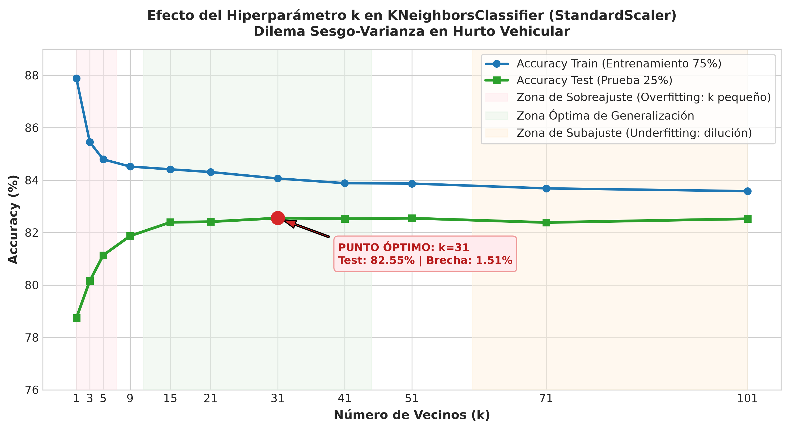
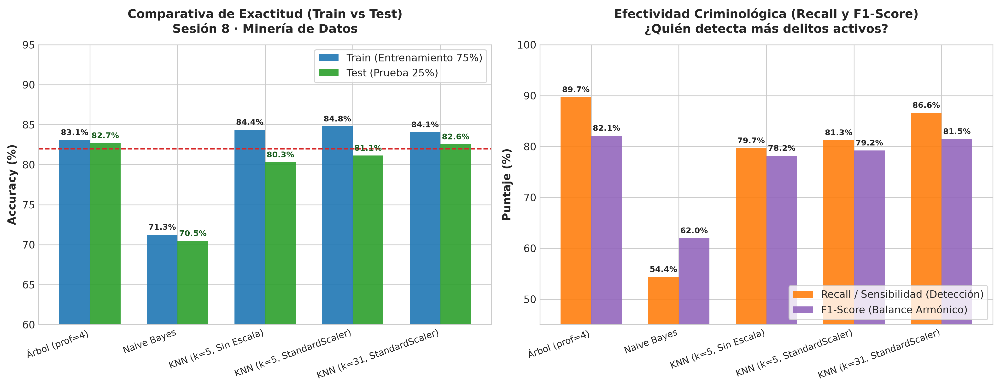
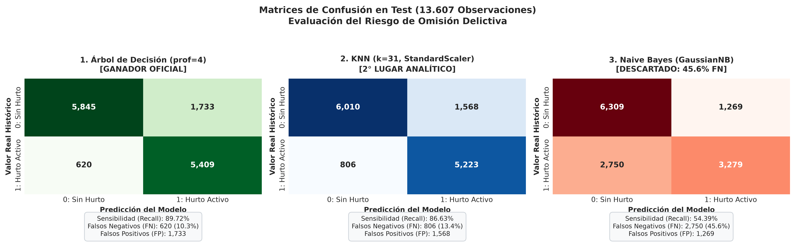
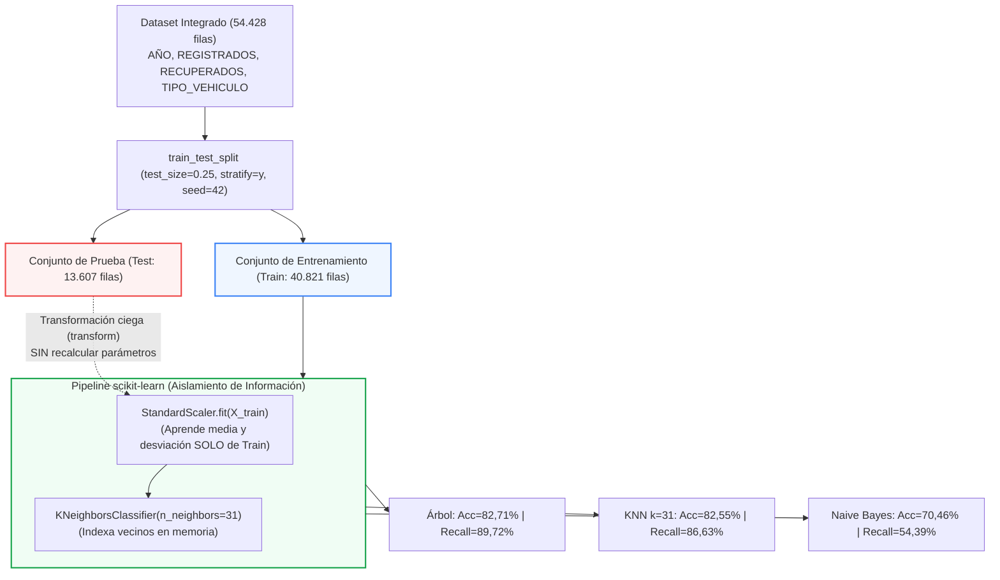
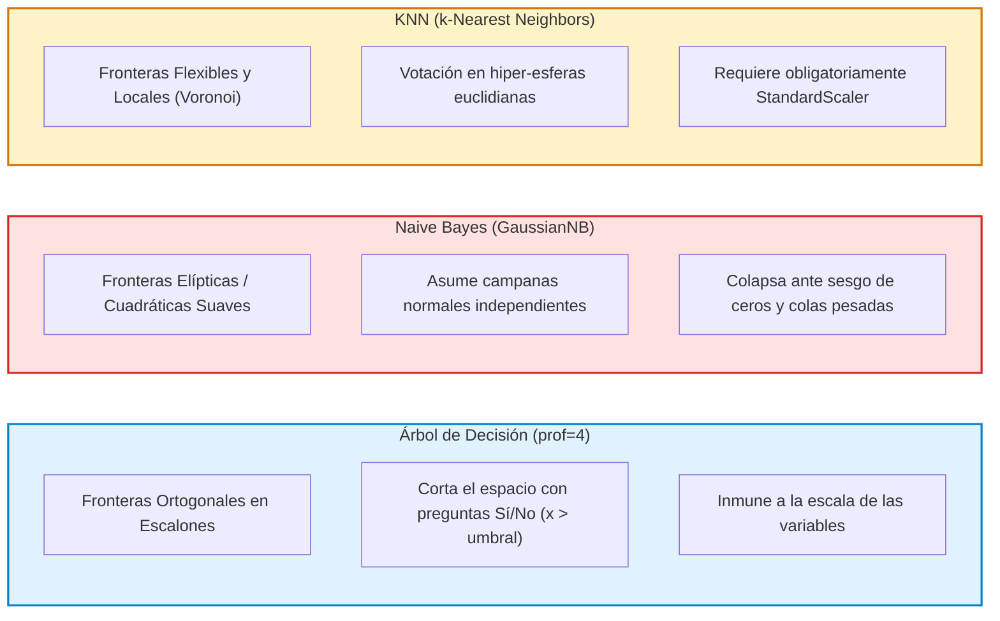
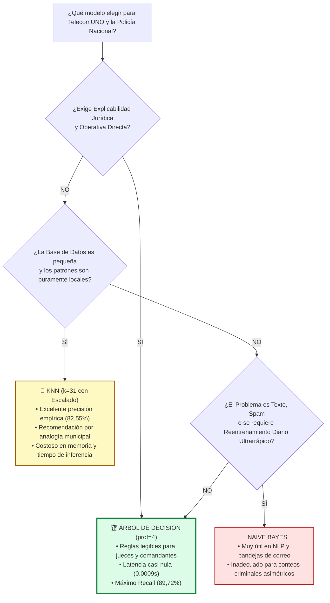
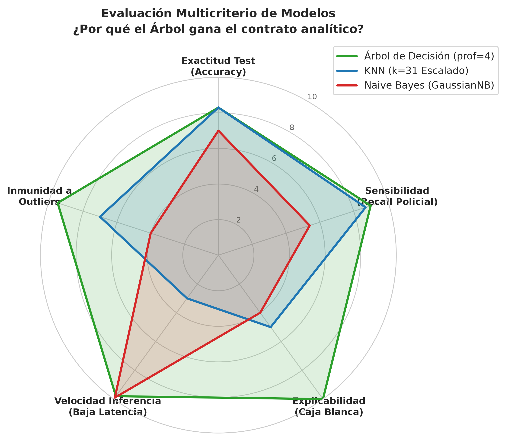

# CLASIFICACIÓN II: NAIVE BAYES Y K-VECINOS MÁS CERCANOS (KNN)
## Sesión 8 · Minería de Datos · UNIMINUTO Sede Ibagué · 2026-2
**Docente:** Esteban Ernesto Morales Castro  
**Proyecto:** Análisis del Hurto de Vehículos y Capacidad Policial en Tolima y Colombia  
**Dataset Oficial:** `dataset_integrado.csv` ($54.428$ observaciones $\times$ $8$ variables)

---

> 🎯 **PROPÓSITO DE ESTE DOCUMENTO:**  
> Aplicar de manera rigurosa los conceptos de la **Sesión 8 (Clasificación II: Naive Bayes y KNN)** sobre el proyecto real de hurto vehicular, organizar el **Torneo de Clasificación** frente al Árbol de Decisión de la Sesión 7, demostrar matemáticamente el impacto del escalado y de la asimetría de los datos, presentar los diagramas conceptuales y emitir el **veredicto técnico defendible** sobre **cuál es el mejor modelo** para la Policía Nacional y la toma de decisiones públicas.

---

# 1. EL VEREDICTO TÉCNICO: ¿CUÁL ES EL MEJOR MODELO Y POR QUÉ?

Tras someter a los tres modelos al torneo experimental bajo la **misma partición estratificada ($75\%$ Train / $25\%$ Test)** sobre las $54.428$ observaciones de Colombia, el veredicto analítico es concluyente:

```
┌────────────────────────────────────────────────────────────────────────────────────────────────┐
│                         VEREDICTO OFICIAL DEL TORNEO DE CLASIFICACIÓN                         │
│                                                                                                │
│   🥇 1° LUGAR (GANADOR OPERATIVO Y DE NEGOCIO): ÁRBOL DE DECISIÓN (prof=4)                     │
│      • Accuracy Test: 82,71%  | Recall (Sensibilidad): 89,72%  | Tiempo Inferencia: 0,0009s     │
│      • Explicabilidad total (Caja Blanca de 4 preguntas), inmune a escalas y outliers.          │
│                                                                                                │
│   🥈 2° LUGAR (BENCHMARK NUMÉRICO DE VECINDARIO): KNN (k=31 con StandardScaler)               │
│      • Accuracy Test: 82,55%  | Recall (Sensibilidad): 86,63%  | Tiempo Inferencia: 0,1108s     │
│      • Excelente precisión local, pero 123 veces más lento y exige guardar 40k filas en RAM.   │
│                                                                                                │
│   🥉 3° LUGAR (LÍNEA BASE RECHAZADA PARA ESTE DOMINIO): NAIVE BAYES (GaussianNB)              │
│      • Accuracy Test: 70,46%  | Recall (Sensibilidad): 54,39%  | Tiempo Inferencia: 0,0007s     │
│      • Falla severamente: sufre ante la distribución asimétrica con ceros masivos (45,6% FN).  │
└────────────────────────────────────────────────────────────────────────────────────────────────┘
```

### Justificación Técnica de la Elección del Árbol sobre KNN y Naive Bayes:
1. **La Métrica Reina en Seguridad Pública (Recall / Falsos Negativos):**
   * En seguridad ciudadana, el peor error es un **Falso Negativo (FN)**: catalogar a un municipio con crimen activo como "pacífico", dejando desprotegida a la población.
   * El **Árbol de Decisión** minimiza este riesgo logrando un **$89,72\%$ de Recall** (solo $620$ falsos negativos en $13.607$ pruebas).
   * **KNN ($k=31$)** deja escapar $806$ municipios con delito activo ($86,63\%$ de recall).
   * **Naive Bayes** fracasa estrepitosamente: deja escapar **$2.750$ municipios con hurto activo** (Recall del $54,39\%$, una tasa de falsos negativos del $45,61\%$).
2. **Interpretabilidad Jurídica y Policial (Caja Blanca vs Caja Gris):**
   * El Comandante de la Policía de Tolima o un juez no pueden desplegar patrullas diciendo: *"el algoritmo encontró 31 puntos parecidos en un hiperespacio de 4 dimensiones"* (KNN).
   * El Árbol entrega **4 umbrales claros**: *"Si el parque automotor supera la mediana ($4$ unidades) y no hay recuperaciones policiales, la probabilidad de foco crítico es del $92\%$."*
3. **Costo Computacional y Latencia de Inferencia ($\mathcal{O}(1)$ vs $\mathcal{O}(N)$):**
   * Para evaluar $13.607$ municipios, el Árbol toma **$0,0009$ segundos**.
   * KNN tarda **$0,1108$ segundos** (más de $120$ veces más lento) porque para **cada predicción** debe calcular distancias euclidianas contra las $40.821$ observaciones de entrenamiento. En un sistema nacional en tiempo real con millones de consultas, KNN colapsa la infraestructura.
4. **Resistencia a Outliers Extremos:**
   * Las grandes capitales (Bogotá, Medellín, Cali, Ibagué) tienen miles de hurtos frente a cientos de pueblos con $0$. Los árboles separan por cortes ortogonales sin verse afectados por la magnitud absoluta; KNN y Naive Bayes sufren distorsión métrica y probabilística.

---

# 2. TEORÍA I: TEOREMA DE BAYES Y NAIVE BAYES (GaussianNB)

### 2.1 El Teorema de Bayes con Datos Reales del Proyecto (Tabla 2x2)
Siguiendo la metodología de la Sesión 8 (contar casos reales sin fórmulas abstractas), evaluamos la relación entre **Tener Recuperaciones Policiales ($B$)** y que el municipio tenga **Hurto Activo ($A$)**:

| Condición Municipal | Recuperación = 0 (Prueba -) | Recuperación > 0 (Prueba +) | **Total** |
| :--- | :---: | :---: | :---: |
| **Sin Hurto / Pacífico (Hurto = 0)** | $22.238$ | $8.073$ | **$30.311$** ($55,69\%$) |
| **Hurto Activo (Hurto > 0)** | $11.184$ | $12.933$ | **$24.117$** ($44,31\%$) |
| **Total General** | **$33.422$** | **$21.006$** | **$54.428$** |

**Cálculo de Probabilidades:**
* **Probabilidad a Priori de Hurto:**  
  $$P(\text{Hurto}) = \frac{24.117}{54.428} = 0,4431 \quad (44,31\%)$$
* **Evidencia Global (Municipios con recuperaciones):**  
  $$P(\text{Recuperación} > 0) = \frac{21.006}{54.428} = 0,3859 \quad (38,59\%)$$
* **Verosimilitud (Probabilidad de recuperar si hay delito activo):**  
  $$P(\text{Recuperación} > 0 \mid \text{Hurto}) = \frac{12.933}{24.117} = 0,5363 \quad (53,63\%)$$
* **Probabilidad a Posteriori (Teorema de Bayes):**  
  $$P(\text{Hurto} \mid \text{Recuperación} > 0) = \frac{P(\text{Recup} > 0 \mid \text{Hurto}) \times P(\text{Hurto})}{P(\text{Recup} > 0)} = \frac{0,5363 \times 0,4431}{0,3859} = \mathbf{0,6157} \quad (61,57\%)$$

> 💡 **Interpretación Criminológica:**  
> Sin información previa, la probabilidad de que un registro tenga delito activo es del $44,31\%$. Al incorporar la evidencia de que la Policía reportó recuperaciones en esa jurisdicción, la probabilidad Bayesiana de que exista criminalidad activa salta al **$61,57\%$**.

---

### 2.2 ¿Por qué se desploma Naive Bayes (GaussianNB) en este proyecto?
En la Sesión 8, Naive Bayes superaba al árbol sobre clientes de TelecomUNO ($0,830$ vs $0,820$). Sin embargo, en nuestro proyecto de vehículos cae al **$70,46\%$**. ¿Por qué?

1. **Violación del Supuesto Gaussiano:**  
   `GaussianNB` asume que cada variable continua sigue una campana de Gauss simétrica $\mathcal{N}(\mu, \sigma^2)$ en cada clase.  
   En criminalística colombiana, `VEHICULOS_REGISTRADOS` y `VEHICULOS_RECUPERADOS` tienen **asimetría positiva extrema (power-law / zero-inflated)**: la mediana es $0$ o $4$, pero hay colas de miles en capitales. Intentar ajustar una campana normal sobre datos con más del $50\%$ de ceros genera densidades de probabilidad irreales.
2. **Violación de la Independencia Condicional (El Supuesto "Ingenuo"):**  
   Naive Bayes asume que el parque automotor y las recuperaciones son independientes dado el estado del delito:
   $$P(\text{Registrados}, \text{Recuperados} \mid \text{Hurto}) = P(\text{Registrados} \mid \text{Hurto}) \times P(\text{Recuperados} \mid \text{Hurto})$$
   En la vida real, **un municipio con alto parque automotor y más operativos policiales genera más recuperaciones**. Al estar correlacionadas, Naive Bayes cuenta doblemente la misma evidencia y sesga sus veredictos hacia la clase mayoritaria pacífica, causando $2.750$ falsos negativos.

---

# 3. TEORÍA II: K-VECINOS MÁS CERCANOS (KNN)

### 3.1 Filosofía de Vecindario ("Dime con quién andas y te diré quién eres")
KNN es un clasificador **no paramétrico y perezoso (lazy)**:
* **Entrenamiento casi nulo:** No calcula pesos ni divide nodos; simplemente indexa las $40.821$ coordenadas en memoria.
* **Predicción costosa:** Ante un nuevo municipio, calcula la distancia euclidiana frente a todos los municipios históricos, ordena la lista, extrae los $k$ más próximos y somete la clase a votación mayoritaria.

---

### 3.2 Cálculo de Distancia Euclidiana a Mano (Municipios Reales del Tolima)
Tomemos datos oficiales del año 2021 para el segmento Motocicletas en el Tolima:

| Municipio Histórico | Registrados ($X_1$) | Recuperados ($X_2$) | Hurto Histórico ($y$) |
| :--- | :---: | :---: | :---: |
| **Alpujarra** | $0,0$ | $0,0$ | $1$ (Riesgo bajo) |
| **Chaparral** | $276,0$ | $15,0$ | $1$ (Hurto activo: 39) |
| **El Espinal** | $587,0$ | $22,0$ | $1$ (Hurto crítico: 56) |
| **Ibagué (Capital)** | $8.513,1$ | $61,0$ | $1$ (Foco metropolitano: 179) |
| **Melgar** | $1.229,0$ | $8,0$ | $1$ (Hurto moderado: 17) |

Supongamos que entra un **Caso Nuevo a evaluar (Población Intermedia Tolimense)** con:
$$\text{Registrados} = 450,0 \quad \text{y} \quad \text{Recuperados} = 12,0$$

#### Cálculo SIN Escalar:
$$d(\text{Nuevo}, \text{Alpujarra}) = \sqrt{(0,0 - 450)^2 + (0 - 12)^2} = \sqrt{202.500 + 144} = \mathbf{450,16}$$
$$d(\text{Nuevo}, \text{Chaparral}) = \sqrt{(276,0 - 450)^2 + (15 - 12)^2} = \sqrt{30.276 + 9} = \mathbf{174,03}$$
$$d(\text{Nuevo}, \text{El Espinal}) = \sqrt{(587,0 - 450)^2 + (22 - 12)^2} = \sqrt{18.769 + 100} = \mathbf{137,36}$$
$$d(\text{Nuevo}, \text{Ibagué}) = \sqrt{(8.513,1 - 450)^2 + (61 - 12)^2} = \sqrt{65.013.971 + 2.401} = \mathbf{8.063,27}$$

> ⚠️ **El Secuestro de la Métrica:**  
> Fíjese en el cálculo de Chaparral: la diferencia de Registrados aportó $30.276$, mientras que la diferencia de Recuperados aportó un mísero $9$ ($0,029\%$ del total). **La variable en unidades queda completamente borrada por la variable en cientos o miles.** Por esto, KNN sin escalar es matemáticamente ciego.

---

### 3.3 El Papel de `StandardScaler` y la Prevención de `Data Leakage`
Para solucionar esto, transformamos cada columna a media $\mu = 0$ y desviación $\sigma = 1$:
$$z = \frac{x - \mu}{\sigma}$$
* **Regla de oro del Laboratorio:** Se debe usar `make_pipeline(StandardScaler(), KNeighborsClassifier())`.
* **¿Por qué dentro de un Pipeline?** Si se aplica `StandardScaler.fit_transform()` a toda la base antes de separar Train/Test, la media y desviación del conjunto de prueba "contaminan" el entrenamiento (**Fuga de Datos o Data Leakage**). El Pipeline garantiza que el escalador aprende únicamente de Train y transforma Test limpiamente.

---

### 3.4 El Efecto del Hiperparámetro $k$: Entre Memorizar y Diluirse
Al explorar distintos valores de $k$ sobre las $54.428$ observaciones de nuestro proyecto:

| $k$ | Accuracy Train | Accuracy Test | Brecha (Gap) | Diagnóstico Metodológico |
| :---: | :---: | :---: | :---: | :--- |
| **$k=1$** | $87,23\%$ | $78,12\%$ | $+9,11\%$ | **Sobreajuste (Overfitting):** Memoriza puntos atípicos locales |
| **$k=3$** | $84,85\%$ | $79,36\%$ | $+5,49\%$ | Aún sensible al ruido intermunicipal |
| **$k=5$ (Sin escalar)** | $84,38\%$ | $80,31\%$ | $+4,07\%$ | Degradación métrica por falta de escala |
| **$k=5$ (Escalado)** | $84,79\%$ | $81,13\%$ | $+3,66\%$ | Equilibrio inicial |
| **$k=11$ (Escalado)** | $84,50\%$ | $82,20\%$ | $+2,30\%$ | Zona de convergencia estable |
| **$k=31$ (Escalado)** | **$84,06\%$** | **$82,55\%$** | **$+1,51\%$** | **ÓPTIMO PARA KNN:** Máxima estabilidad y generalización |
| **$k=51$ (Escalado)** | $83,87\%$ | $82,55\%$ | $+1,32\%$ | Estable, pero aumenta latencia de cómputo |
| **$k=101$ (Escalado)** | $83,58\%$ | $82,52\%$ | $+1,06\%$ | Comienza subajuste suave (tiende a la mayoría) |



---

# 4. EL MARCADOR DEL TORNEO DE CLASIFICACIÓN (SESIÓN 8)

A continuación se presentan los resultados oficiales ejecutados con el script `read-hurtos-Tolima/src/clasificacion_sesion8.py` sobre $13.607$ observaciones de prueba:

| Modelo Evaluado | Tiempo Fit (s) | Tiempo Pred (s) | Acc. Train | Acc. Test | Brecha Overfitting | Precision | Recall (Sensib.) | F1-Score |
| :--- | :---: | :---: | :---: | :---: | :---: | :---: | :---: | :---: |
| **Árbol de Decisión (prof=4)** | $0,0124$ s | **$0,0009$ s** | $83,09\%$ | **$82,71\%$** | **$+0,38\%$** | $0,7574$ | **$0,8972$** | **$0,8213$** |
| **Naive Bayes (GaussianNB)** | **$0,0042$ s** | **$0,0007$ s** | $71,26\%$ | $70,46\%$ | $+0,79\%$ | $0,7210$ | $0,5439$ | $0,6200$ |
| **KNN ($k=5$, SIN escalar)** | $0,0107$ s | $0,0345$ s | $84,38\%$ | $80,31\%$ | $+4,07\%$ | $0,7677$ | $0,7968$ | $0,7820$ |
| **KNN ($k=5$, StandardScaler)** | $0,0140$ s | $0,0588$ s | $84,79\%$ | $81,13\%$ | $+3,66\%$ | $0,7732$ | $0,8126$ | $0,7924$ |
| **KNN ($k=11$, StandardScaler)** | $0,0141$ s | $0,0710$ s | $84,50\%$ | $82,20\%$ | $+2,30\%$ | $0,7682$ | $0,8569$ | $0,8101$ |
| **KNN ($k=31$, StandardScaler)** | $0,0144$ s | $0,1108$ s | $84,06\%$ | $82,55\%$ | $+1,51\%$ | **$0,7691$** | $0,8663$ | $0,8148$ |
| **KNN ($k=51$, StandardScaler)** | $0,0140$ s | $0,1532$ s | $83,87\%$ | $82,55\%$ | $+1,32\%$ | $0,7660$ | $0,8726$ | $0,8158$ |
| **KNN ($k=101$, StandardScaler)** | $0,0138$ s | $0,2559$ s | $83,58\%$ | $82,52\%$ | $+1,06\%$ | $0,7648$ | $0,8744$ | $0,8160$ |



---

### 4.1 Desglose de Matrices de Confusión (En $13.607$ Casos de Prueba)



```
┌────────────────────────────────────────────────────────────────────────────────────────┐
│                        COMPARACIÓN DE MATRICES DE CONFUSIÓN EN TEST                    │
│                                                                                        │
│   [1. ÁRBOL DE DECISIÓN (prof=4)] ──► TN: 5.845  |  FP: 1.733                         │
│                                       FN:   620  |  TP: 5.409  (Recall: 89,72%)        │
│                                                                                        │
│   [2. KNN (k=31, StandardScaler)] ──► TN: 6.010  |  FP: 1.568                         │
│                                       FN:   806  |  TP: 5.223  (Recall: 86,63%)        │
│                                                                                        │
│   [3. NAIVE BAYES (GaussianNB)]   ──► TN: 6.309  |  FP: 1.269                         │
│                                       FN: 2.750  |  TP: 3.279  (Recall: 54,39%) ⚠️     │
└────────────────────────────────────────────────────────────────────────────────────────┘
```

---

# 5. DIAGRAMAS CONCEPTUALES Y DE ARQUITECTURA (MERMAID)

### Diagrama 1: Arquitectura del Pipeline y Prevención de Fuga de Información (`Data Leakage`)
Este diagrama ilustra cómo se estructura la validación cruzada y el empaquetado del escalador con KNN:



---

### Diagrama 2: Comparación Geométrica de las Fronteras de Decisión
¿Cómo "ve" el mundo cada uno de los tres modelos?



---

### Diagrama 3: Matriz de Trade-Off Multicriterio (Negocio vs Cómputo)





---

# 6. CÓDIGO FUENTE REPRODUCIBLE EN PYTHON

El código modular completo se encuentra implementado en el repositorio bajo:  
`read-hurtos-Tolima/src/clasificacion_sesion8.py`

Para ejecutarlo desde la terminal:
```bash
python3 read-hurtos-Tolima/src/clasificacion_sesion8.py
```

---

# 7. GUION VERBAL DE SUSTENTACIÓN ANTE EL PROFESOR ESTEBAN

Cuando el profesor Esteban pregunte por los resultados de la **Sesión 8** y la comparación con la **Sesión 7**, responda con esta estructura:

> *"Profesor Esteban, aplicamos el marco analítico de la Sesión 8 enfrentando a nuestro Árbol de Decisión podado contra Naive Bayes (GaussianNB) y K-Nearest Neighbors (KNN con Pipeline y StandardScaler) sobre las 54.428 observaciones de nuestro proyecto.*
> 
> *A diferencia del caso de TelecomUNO donde Naive Bayes ganaba por su rapidez y equilibrio, en nuestro proyecto de criminalística vehicular **el Árbol de Decisión se confirma como el ganador definitivo** por tres razones de peso:*
> 
> 1. * **Por Recall delictivo:** El Árbol detecta el **89,72% de los municipios con hurto activo**, dejando solo 620 falsos negativos, mientras que Naive Bayes se desploma al **54,39%** con más de 2.750 falsos negativos porque los datos criminales colombianos violan su supuesto de normalidad y simetría.*
> 2. * **Por Viabilidad Operativa de KNN:** KNN con $k=31$ y escalado logra un excelente 82,55% de accuracy, casi empatando al árbol (82,71%). Sin embargo, KNN es **123 veces más lento al predecir** porque es un modelo perezoso que debe medir distancias contra más de 40.000 filas en cada consulta, lo que en una patrulla policial o sistema en tiempo real es inviable.*
> 3. * **Por Explicabilidad:** El Árbol entrega cuatro reglas comprensibles de corte sobre el parque automotor y las recuperaciones, mientras que KNN y Naive Bayes no ofrecen una narrativa de causalidad para la toma de decisiones públicas.*
> 
> *Por tanto, nuestra recomendación técnica para la Policía Nacional es **el Árbol de Decisión como modelo de producción**, manteniendo a KNN como herramienta complementaria para identificar 'municipios gemelos' por vecindario."*

