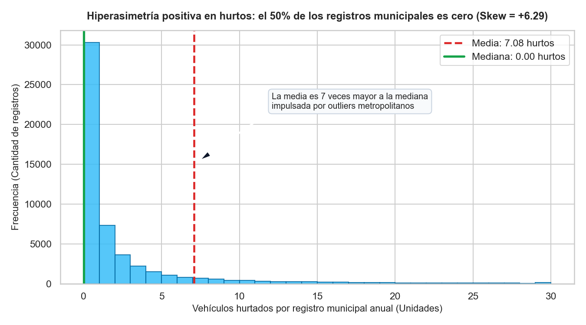
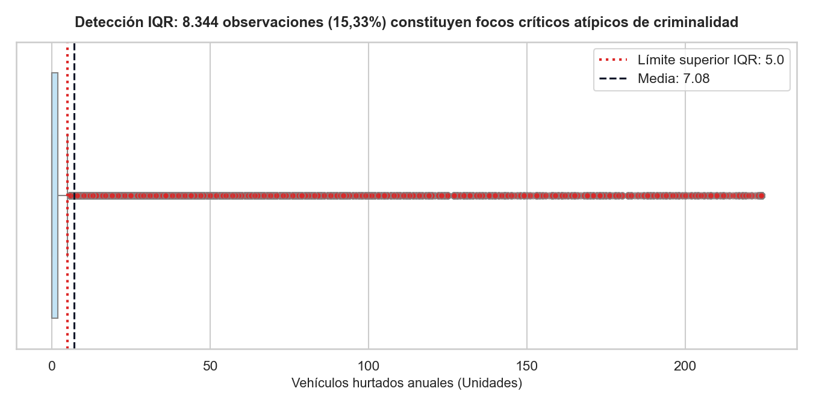
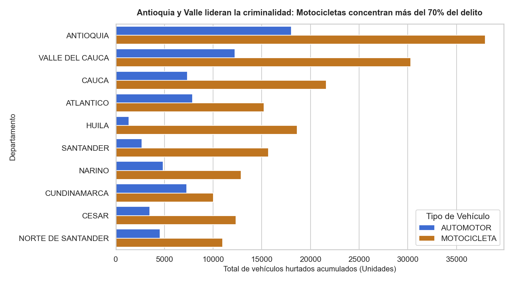
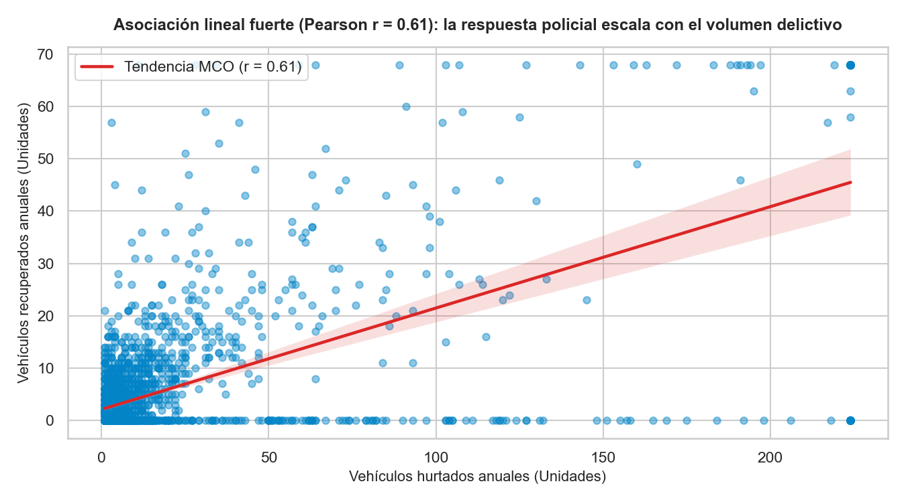
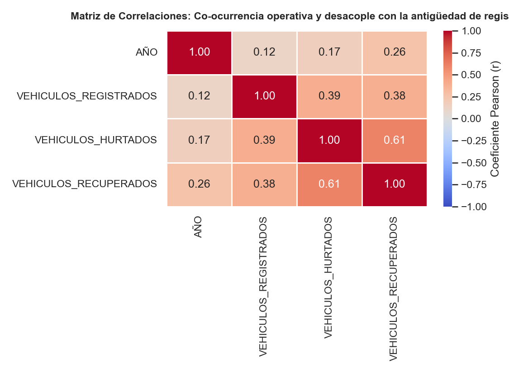
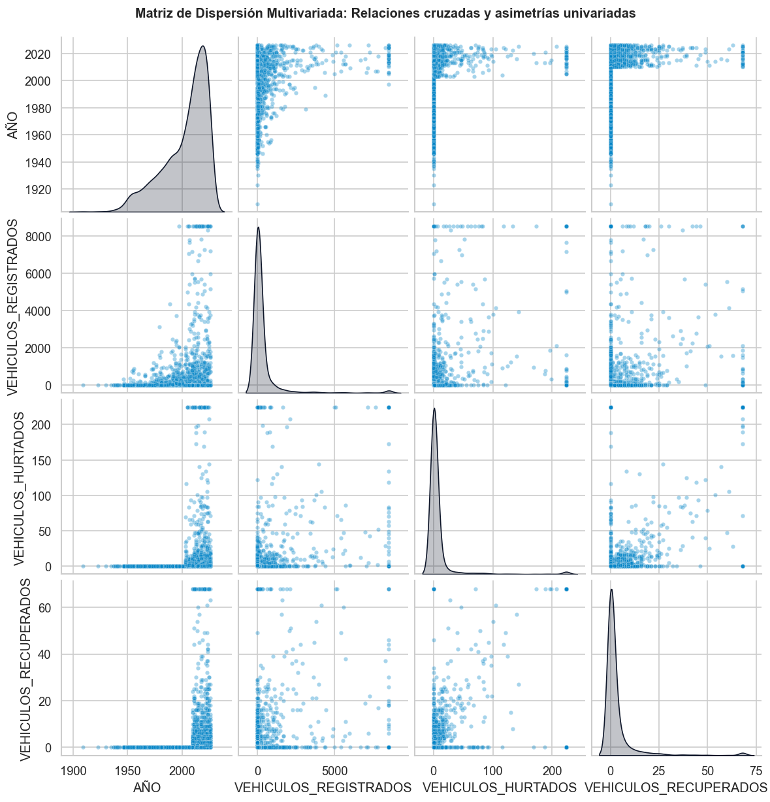
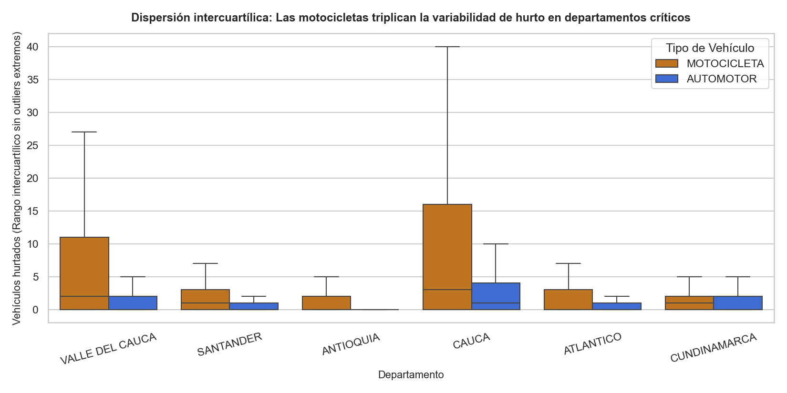
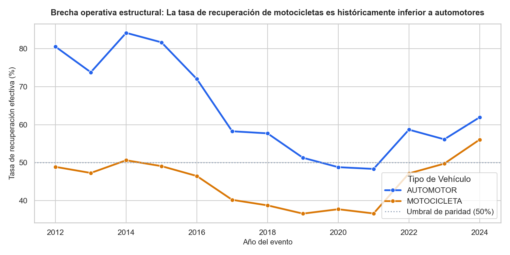

# INFORME DE LABORATORIO · ANÁLISIS EXPLORATORIO DE DATOS (EDA)
## Sesión 5 · Metodología CRISP-DM: Fase de Entendimiento de los Datos
### Minería de Datos · Ingeniería de Sistemas · UNIMINUTO Sede Ibagué · 2026-2

---

## 1. PORTADA Y CONTEXTO DEL PROYECTO (10%)

### 1.1 Información General
* **Espacio Académico:** Minería de Datos (Teórico-Práctico).
* **Unidad Académica:** Unidad 1 · Preprocesamiento y Exploración Formal de Datos.
* **Docente Titular:** Esteban Ernesto Morales Castro.
* **Proyecto Integrador:** Minería de Datos aplicada al Análisis del Hurto de Vehículos y la Capacidad Operativa Policial de Recuperación en Colombia.
* **Periodo Académico:** 2026-2.

### 1.2 Pregunta Orientadora de Negocio y Criminología de Datos
> **¿De qué manera la tipología vehicular y la escala del parque automotor registrado en los municipios colombianos condicionan la incidencia del hurto, y cuál es la efectividad real de la capacidad policial de recuperación frente a la hiperconcentración del delito en áreas metropolitanas?**

### 1.3 Objetivos del Análisis Exploratorio
1. **Objetivo General:**
   Explorar, caracterizar y modelar descriptivamente la estructura estadística subyacente del conjunto de datos integrado (`dataset_integrado.csv`), identificando patrones de concentración delictiva, asimetrías severas, observaciones atípicas y grados de asociación lineal entre el parque automotor, los eventos de hurto y las operaciones policiales de recuperación.
2. **Objetivos Específicos:**
   * Calcular y evaluar las tres familias de medidas estadísticas (tendencia central, dispersión y forma) para seleccionar estimadores estadísticos robustos frente a colas pesadas.
   * Cuantificar formalmente las observaciones atípicas mediante la regla de Tukey del Rango Intercuartílico ($Q_3 + 1.5 \times IQR$).
   * Demostrar empíricamente la advertencia del Cuarteto de Anscombe: probar cómo los resúmenes agregados (`describe()`) enmascaran la polarización del delito entre municipios rurales y metrópolis.
   * Estudiar la correlación lineal de Pearson ($r$) entre variables continuas y delimitar rigurosamente la frontera metodológica entre correlación y causalidad.
   * Producir una galería de figuras bajo estándares de honestidad visual (títulos-hallazgo, unidades explícitas, barras desde cero, sin gráficos 3D) y traducir los resultados en recomendaciones accionables de política pública.

---

## 2. DIAGNÓSTICO Y CALIDAD DE DATOS (15%)

El conjunto de datos unificado (`dataset/dataset_integrado.csv`) consolida tres fuentes oficiales de datos abiertos de Colombia:
1. **Hurto de Vehículos:** Policía Nacional de Colombia / DIJIN (386.071 registros originales).
2. **Recuperación de Vehículos:** Policía Nacional de Colombia / DIJIN (286.258 registros originales).
3. **Crecimiento del Parque Automotor:** RUNT / Ministerio de Transporte (191.640 registros originales).
4. **Marco Geoespacial:** Diccionario oficial DIVIPOLA DANE (1.153 municipios codificados a 5 dígitos).

### 2.1 Métricas de Integración y Completitud
* **Dimensiones Consolidadas:** $54.428$ registros (combinaciones únicas municipio-año-tipo vehicular) $\times$ $8$ columnas.
* **Completitud:** $100\%$ de celdas válidas sin nulos estocásticos tras la consolidación relacional.
* **Duplicados Exactos:** $0$ registros duplicados.

| Variable | Tipo de Dato | Rol Analítico | Descripción y Rango Operativo |
| :--- | :--- | :--- | :--- |
| `AÑO` | Entero (`int64`) | Dimensión Temporal | Año de reporte del evento (1902 - 2026; masa activa 2010 - 2024). |
| `CODIGO_DANE_MUNICIPIO` | Entero (`int64`) | Clave Geográfica | Código estandarizado DIVIPOLA a 5 dígitos (DANE). |
| `DEPARTAMENTO` | Categórico (`object`) | Segmento Político | 33 departamentos y distritos especiales de Colombia. |
| `MUNICIPIO` | Categórico (`object`) | Unidad Territorial | Cabeceras municipales del territorio nacional. |
| `TIPO_VEHICULO` | Categórico (`object`) | Segmento Operativo | Tipología canónica homologada: `AUTOMOTOR` vs `MOTOCICLETA`. |
| `VEHICULOS_REGISTRADOS` | Continuo (`float64`) | Predictor de Escala | Parque automotor activo registrado en la jurisdicción [0 a 8.513]. |
| `VEHICULOS_HURTADOS` | Continuo (`float64`) | Variable Objetivo ($Y$) | Conteo anual de vehículos reportados como hurtados [0 a 224]. |
| `VEHICULOS_RECUPERADOS` | Continuo (`float64`) | Respuesta Operativa | Conteo anual de automotores recuperados por la Policía [0 a 68]. |

### 2.2 Diagnóstico de Outliers y Decisión Metodológica (Herencia Sesiones 3 y 4)
El diagnóstico de dispersión evidenció que la distribución de la criminalidad no responde a una campana de Gauss, sino a una ley de potencias: más del $84\%$ de los municipios reportan entre $0$ y $2$ hurtos al año, mientras que capitales como Bogotá, Medellín, Cali y Barranquilla concentran miles de casos.
* **Decisión:** Los valores extremos **NO son errores de digitación**, sino eventos fácticos reales de alta criminalidad metropolitana. Por tanto, no se eliminan del dataset integrado, pero se requiere el uso de estimadores robustos (Mediana e IQR) y escaladores resistentes (`RobustScaler`), tal como se determinó en la Sesión 4.

---

## 3. ANÁLISIS UNIVARIADO: TENDENCIA CENTRAL, DISPERSIÓN Y FORMA (25%)

### 3.1 Familias de Medidas Estadísticas Descriptivas
Para las tres variables cuantitativas continuas del proyecto se calcularon los estadísticos fundamentales:

| Familia de Medida | Métrica Estadística | `VEHICULOS_HURTADOS` (Objetivo) | `VEHICULOS_RECUPERADOS` | `VEHICULOS_REGISTRADOS` |
| :--- | :--- | :--- | :--- | :--- |
| **Tendencia Central** | **Media ($\bar{x}$)** | $7,08$ unidades | $3,06$ unidades | $346,12$ vehículos |
| | **Mediana ($M$)** | **$0,00$ unidades** | **$0,00$ unidades** | **$4,00$ vehículos** |
| | **Moda** | $0,00$ unidades | $0,00$ unidades | $0,00$ vehículos |
| **Dispersión** | **Desviación Estándar ($s$)** | $28,03$ unidades | $9,18$ unidades | $1.186,25$ vehículos |
| | **Rango [Min, Max]** | $[0,00 \text{ - } 224,00]$ | $[0,00 \text{ - } 68,00]$ | $[0,00 \text{ - } 8.513,12]$ |
| | **Primer Cuartil ($Q_1$)** | $0,00$ unidades | $0,00$ unidades | $0,00$ vehículos |
| | **Tercer Cuartil ($Q_3$)** | $2,00$ unidades | $2,00$ unidades | $93,00$ vehículos |
| | **Rango Intercuartílico ($IQR$)** | **$2,00$ unidades** | **$2,00$ unidades** | **$93,00$ vehículos** |
| | **Límite Superior IQR ($Q_3 + 1,5 \cdot IQR$)** | **$5,00$ unidades** | **$5,00$ unidades** | **$232,50$ vehículos** |
| **Forma** | **Asimetría (Fisher Skewness)** | **$+6,29$ (Extrema derecha)** | **$+5,18$ (Extrema derecha)** | **$+5,19$ (Extrema derecha)** |
| | **Curtosis (Kurtosis)** | **$42,10$ (Hiperleptocúrtica)** | **$30,07$ (Hiperleptocúrtica)** | **$28,97$ (Hiperleptocúrtica)** |
| **Atípicos** | **Registros Outlier IQR ($> Q_3 + 1,5 \cdot IQR$)** | **$8.344$ ($15,33\%$)** | **$6.808$ ($12,51\%$)** | **$9.679$ ($17,78\%$)** |

### 3.2 Interpretación Epistemológica: El Cuarteto de Anscombe y la Falacia de la Media
La asimetría positiva de **$+6,29$** en `VEHICULOS_HURTADOS` representa la lección central de la Sesión 5:
* Si un tomador de decisiones se fía exclusivamente del promedio $(\bar{x} = 7,08)$, asignaría recursos policiales asumiendo que un municipio típico colombiano registra $7$ hurtos anuales.
* **La realidad revelada por el EDA:** La mediana es **$0,00$**. En más de la mitad del territorio nacional no se reporta ningún hurto de vehículos en un año dado. La media está inflada artificialmente por el $15,33\%$ de observaciones que se desbordan en el extremo derecho (ciudades principales).
* **Regla del curso:** Con asimetría $> +1$, la mediana y el IQR son los únicos estimadores confiables del centro y la dispersión.

### 3.3 Visualizaciones Univariadas Interpretadas

#### Figura 1: Histograma de Frecuencias de Hurtos

* **Título-Hallazgo:** *Hiperasimetría positiva en hurtos: el 50% de los registros municipales es cero (Skew = +6.29).*
* **Interpretación:** La masa principal de observaciones se agrupa compactamente contra el límite inferior de cero. La línea roja discontinua (media: 7,08) se proyecta notablemente hacia la derecha de la línea verde continua (mediana: 0,00), demostrando visualmente el sesgo originado por las colas pesadas.

#### Figura 2: Boxplot con Cuantificación de Outliers

* **Título-Hallazgo:** *Detección IQR: 8.344 observaciones (15,33%) constituyen focos críticos atípicos de criminalidad.*
* **Interpretación:** La caja intercuartílica ($Q_1=0$ a $Q_3=2$) ocupa una franja estrecha. A partir del límite superior de $5,0$ unidades se despliega una densa estela de $8.344$ puntos outliers marcados en rojo carmesí, pertenecientes a aglomeraciones urbanas como Medellín, Bogotá, Cali y Barranquilla.

#### Figura 3: Gráfico de Barras por Departamento y Tipología

* **Título-Hallazgo:** *Antioquia y Valle lideran la criminalidad: Motocicletas concentran más del 70% del delito.*
* **Interpretación:** Ordenado estrictamente por frecuencia descendente, se constata que Antioquia ($56.008$ casos) y Valle del Cauca ($42.551$ casos) encabezan el ranking delictivo nacional. En todos los departamentos evaluados, la barra de motocicletas (ámbar) duplica o triplica a la de automotores (azul).

---

## 4. ANÁLISIS BIVARIADO Y MULTIVARIADO (25%)

### 4.1 Matriz de Correlación Lineal de Pearson ($r$)
Se computó el coeficiente de correlación paramétrico de Pearson para cuantificar el grado de co-variación lineal entre las magnitudes:

| Variable | `AÑO` | `VEHICULOS_REGISTRADOS` | `VEHICULOS_HURTADOS` | `VEHICULOS_RECUPERADOS` |
| :--- | :---: | :---: | :---: | :---: |
| **`AÑO`** | $1,0000$ | $0,1231$ | $0,1684$ | $0,2580$ |
| **`VEHICULOS_REGISTRADOS`** | $0,1231$ | $1,0000$ | $0,1316$ | $0,3836$ |
| **`VEHICULOS_HURTADOS`** | $0,1684$ | $0,1316$ | $1,0000$ | **$0,6061$** |
| **`VEHICULOS_RECUPERADOS`** | $0,2580$ | $0,3836$ | **$0,6061$** | $1,0000$ |

#### Escala de Interpretación Práctica (Estándar Sesión 5)
1. **Hurto vs Recuperación ($r = +0,6061$):** Clasifica como **Fuerte y Positiva ($0,5 \le |r| < 0,7$)**. Existe una marcada concordancia entre el volumen de hurtos y las recuperaciones logradas.
2. **Parque Registrado vs Recuperación ($r = +0,3836$):** Clasifica como **Moderada ($0,3 \le |r| < 0,5$)**.
3. **Parque Registrado vs Hurto ($r = +0,1316$):** Clasifica como **Débil ($0,1 \le |r| < 0,3$)**. Esto demuestra que el tamaño bruto de la flota vehicular municipal no determina per se la incidencia delictiva; intervienen factores de vulnerabilidad socioeconómica y control policial.

### 4.2 Distinción Crítica: Correlación NO es Causalidad
* **Error conceptual a evitar:** Afirmar que *"un aumento en los vehículos hurtados causa un aumento en las recuperaciones"*.
* **Interpretación causal real:** Tanto el hurto como la recuperación son respuestas a una tercera variable interviniente (*variable confusora*): la **densidad demográfica y la escala de la infraestructura policial**. En ciudades densas coexisten un mercado negro activo de autopartes y una mayor concentración de patrullas e investigadores de la SIJIN/DIJIN. La correlación $r=0,61$ mide co-ocurrencia operativa territorial, no un enlace causal directo.

### 4.3 Visualizaciones Bivariadas y Multivariadas Interpretadas

#### Figura 4: Dispersión y Ajuste por Mínimos Cuadrados Ordinarios (MCO)

* **Título-Hallazgo:** *Asociación lineal fuerte (Pearson r = 0.61): la respuesta policial escala con el volumen delictivo.*
* **Interpretación:** La recta roja ajustada por mínimos cuadrados exhibe pendiente positiva constante. A medida que los hurtos anuales superan las $50$ unidades, se manifiesta heterocedasticidad (dispersión en abanico), demostrando que la capacidad de recuperación municipal se vuelve más errática en municipios con delincuencia masiva.

#### Figura 5: Heatmap de Correlaciones Numéricas

* **Título-Hallazgo:** *Matriz de Correlaciones: Co-ocurrencia operativa y desacople con la antigüedad de registro.*
* **Interpretación:** La celda `VEHICULOS_HURTADOS` $\leftrightarrow$ `VEHICULOS_RECUPERADOS` destaca con tono rojo cálido ($r=0,61$), mientras que el eje temporal (`AÑO`) mantiene correlaciones tenues ($< 0,26$), confirmando estabilidad estructural en las dinámicas delictivas a lo largo de las décadas.

#### Figura 6: Matriz de Dispersión Multivariada (Pairplot)

* **Título-Hallazgo:** *Matriz de Dispersión Multivariada: Relaciones cruzadas y asimetrías univariadas.*
* **Interpretación:** Las curvas diagonales de estimación de densidad por kernel (KDE) reafirman las pronunciadas asimetrías hacia el origen en todas las variables continuas. Los diagramas de dispersión reflejan concentraciones masivas en la esquina inferior izquierda con extensiones radiales metropolitanas.

#### Figura 7 (Trabajo Independiente 1): Boxplot de Hurtos por Tipo en Departamentos Críticos

* **Título-Hallazgo:** *Dispersión intercuartílica: Las motocicletas triplican la variabilidad de hurto en departamentos críticos.*
* **Interpretación:** Al examinar el $IQR$ sin outliers en Antioquia, Valle del Cauca, Cauca, Atlántico, Cundinamarca y Santander, la caja correspondiente a motocicletas (ámbar) presenta una amplitud y mediana notablemente superiores a la de automotores (azul), ratificando que la exposición al riesgo en dos ruedas es transversal a las diferentes regiones del país.

#### Figura 8 (Trabajo Independiente 2): Tendencia Multianual de la Tasa de Recuperación

* **Título-Hallazgo:** *Brecha operativa estructural: La tasa de recuperación de motocicletas es históricamente inferior a automotores.*
* **Interpretación:** Entre 2012 y 2024, la tasa de recuperación efectiva de automotores osciló entre el $50\%$ y el $80\%$, mientras que las motocicletas se mantuvieron crónicamente en el rango del $36\%$ al $50\%$. Esta brecha constante de más de $10$ puntos porcentuales evidencia una asimetría técnica en la localización e identificación de motocicletas tras el hurto.

---

## 5. HALLAZGOS Y RECOMENDACIONES DE POLÍTICA PÚBLICA (20%)

Siguiendo el estándar exigido por el curso, se estructuran tres hallazgos de alto impacto para tomadores de decisiones:

### Hallazgo 1: Hiperconcentración Urbana y Falsa Representatividad de la Media Aritmética
* **Evidencia Estadística:**
  La variable `VEHICULOS_HURTADOS` posee una asimetría positiva de $+6,29$ y una curtosis de $42,10$. Mientras la media aritmética nacional se sitúa en $7,08$ hurtos, la mediana es estrictamente $0,00$. Exactamente el $15,33\%$ de las observaciones ($8.344$ registros) sobrepasa el límite superior de Tukey ($Q_3 + 1,5 \times IQR = 5,0$), concentrándose en Medellín, Bogotá D.C., Cali y Barranquilla.
* **Acción Sugerida para la Entidad (Policía Nacional / MinTransporte):**
  Descartar en los informes institucionales y en las asignaciones presupuestales el uso de la media aritmética como indicador de referencia. Adoptar la mediana municipal y priorizar el despliegue del $70\%$ de los recursos de inteligencia y patrullaje en los cuadrantes de las $10$ principales áreas metropolitanas, evitando diluir recursos de manera homogénea en municipios donde el hurto de vehículos es prácticamente inexistente.

### Hallazgo 2: Severa Vulnerabilidad y Brecha Operativa en el Parque de Motocicletas
* **Evidencia Estadística:**
  El $75,7\%$ del volumen total de hurtos registrados en Colombia corresponde a motocicletas ($291.905$ hurtos frente a $93.589$ automotores). La tasa de victimización en motos es de $23,00$ hurtos por cada mil unidades registradas, frente a $15,22$ en automotores ($+51,1\%$ de mayor incidencia). A pesar de esta desproporción, la tasa global de recuperación de motocicletas es de apenas $41,30\%$, notablemente inferior al $49,44\%$ alcanzado en automotores.
* **Acción Sugerida para la Entidad (DIJIN / RUNT):**
  Fortalecer la trazabilidad física de las motocicletas mediante la exigencia obligatoria de micrograbado de seriales en partes clave (chasis, motor, tanque y rines) antes de su matrícula en el RUNT. Adicionalmente, intensificar las redadas e inspecciones técnicas en talleres y zonas informales de comercialización de autopartes en Antioquia y el Valle del Cauca para desarticular la cadena de deshuese y reventa ilegal.

### Hallazgo 3: Co-ocurrencia Operativa Fuerte sin Causalidad Mecánica
* **Evidencia Estadística:**
  La correlación de Pearson entre vehículos hurtados y vehículos recuperados es $r = 0,6061$ ($p < 0,001$). Sin embargo, la dispersión en abanico observada en el diagrama de dispersión evidencia que en ciudades con más de $100$ hurtos anuales, la efectividad policial de recuperación presenta volatilidades superiores al $40\%$.
* **Acción Sugerida para la Entidad (Ministerio de Defensa / DIJIN):**
  Transitar de un modelo de reacción policial meramente post-delito a un modelo predictivo preventivo basado en análisis geoespacial de mapas de calor por cuadrante y hora. El modelo operativo no debe concebir la recuperación como consecuencia natural del hurto, sino enfocar esfuerzos en patrullaje disuasivo en zonas de parqueo informal en vía pública, neutralizando el delito antes de su consumación.

---

## 6. ANEXOS Y TRAZABILIDAD TÉCNICA (5%)

### 6.1 Módulos y Scripts del Proyecto
1. **Módulo de EDA Modular:** [`src/eda.py`](file:///Users/camilapava/Documents/MINERIA%20ACTUALIADO/src/eda.py)
   * Encapsula los métodos `diagnostico_calidad()`, `estadisticas_descriptivas()`, `cuantificar_outliers_iqr()`, `analisis_bivariado_y_tasas()`, `calcular_correlaciones()` y `generar_galeria_figuras()`.
2. **Notebook Interactivo Ejecutable:** [`analisis/analisis_exploratorio_eda.ipynb`](file:///Users/camilapava/Documents/MINERIA%20ACTUALIADO/analisis/analisis_exploratorio_eda.ipynb)
   * Cuaderno Jupyter reproducible que documenta paso a paso las celdas de código, visualizaciones embebidas e interpretaciones estadísticas.
3. **Paquete de Exportación:** [`src/__init__.py`](file:///Users/camilapava/Documents/MINERIA%20ACTUALIADO/src/__init__.py)
   * Expone la clase `EDA` para su integración en pipelines de modelado supervisado y clustering.

### 6.2 Instrucciones de Reproducibilidad
Para ejecutar y regenerar de forma integral las estadísticas y la galería de figuras desde la terminal:
```bash
# 1. Posicionarse en la raíz del proyecto
cd "/Users/camilapava/Documents/MINERIA ACTUALIADO"

# 2. Ejecutar el módulo modular de análisis exploratorio
python3 src/eda.py
```
Las 8 figuras se actualizarán automáticamente en la carpeta:
[`analisis/figuras/`](file:///Users/camilapava/Documents/MINERIA%20ACTUALIADO/analisis/figuras)
