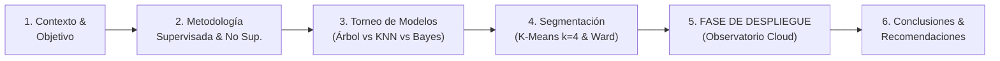

# GUION Y ESTRUCTURA DE DIAPOSITIVAS PARA SUSTENTACIÓN EN AUDITORIO
## Observatorio de Minería de Datos: Hurto y Recuperación de Vehículos en Colombia (Énfasis Tolima)

* **Institución:** Corporación Universitaria Minuto de Dios — UNIMINUTO (Sede Ibagué)
* **Programa:** Ingeniería de Sistemas — Minería de Datos (Corte 3)
* **Docente Evaluador:** Esteban Ernesto Morales Castro
* **Autoras:** Natalia Valencia & Camila Pava
* **Modalidad:** Sustentación presencial en auditorio
* **Tiempo estimado:** 10 a 12 minutos (aprox. 1 minuto por diapositiva)
* **Formato:** 9 Diapositivas de alto impacto con notas para el orador (Speaker Notes)

---



---

## DIAPOSITIVA 1: Portada Oficial & Apertura

### Contenido Visual de la Diapositiva
* **Título:** Sistema de Inteligencia y Minería de Datos: Análisis Predictivo del Hurto y Capacidad de Recuperación Vehicular en Colombia
* **Subtítulo:** Evaluación Empírica Territorial con Énfasis en el Departamento del Tolima
* **Autoras:** Natalia Valencia & Camila Pava
* **Docente:** Ing. Esteban Ernesto Morales Castro
* **Filiación:** UNIMINUTO Ibagué · 2026-2

### 🎙️ Guion Verbal del Orador (Qué decir en el auditorio):
> *"Buenos días, profesor Esteban y compañeros de auditorio. Hoy, junto con mi compañera Natalia Valencia, nos complace presentar nuestro proyecto final de Minería de Datos: el diseño, modelado y despliegue en la nube de un **Observatorio de Inteligencia y Predicción del Hurto Vehicular en Colombia**, con un enfoque analítico particular en el departamento del **Tolima**. A través de este trabajo transformamos más de 54,000 registros policiales históricos en una herramienta analítica viva y accionable para la toma de decisiones en seguridad ciudadana."*

---

## DIAPOSITIVA 2: Contexto del Problema y Justificación

### Contenido Visual de la Diapositiva
* **Magnitud del problema:** El hurto automotor y de motocicletas es el delito patrimonial de mayor impacto económico y desestabilizador en la percepción ciudadana en Colombia.
* **Corpus de datos consolidado:**
  * **54,428 observaciones municipales** integradas (1902–2024).
  * **Foco analítico moderno:** 27,577 registros consolidados post-2010.
  * Variables clave: Parque Automotor Registrado, Hurtos Denunciados, Recuperaciones Policiales Efectivas.
* **Problemática operativa:** Los planes de seguridad tradicionales aplican patrullajes reactivos genéricos sin diferenciar la masa crítica del parque automotor ni la tipología del vehículo.

### 🎙️ Guion Verbal del Orador:
> *"Para dimensionar el problema, el hurto de vehículos no es solo una pérdida material individual; es el motor financiero de estructuras de crimen organizado dedicadas al desguace y la receptación de repuestos. Integramos una base histórica de 54,428 registros policiales y de tránsito a nivel municipal. Al analizar el periodo moderno descubrimos que los recursos de la Fuerza Pública se distribuyen de forma reactiva, sin un fundamento analítico que anticipe qué municipios están a punto de sobrepasar su capacidad operativa."*

---

## DIAPOSITIVA 3: Pregunta de Investigación y Objetivo General

### Contenido Visual de la Diapositiva
* **Pregunta de Investigación Central:**
  > *"¿De qué manera la tipología vehicular y la escala del parque automotor registrado en los municipios colombianos condicionan la incidencia del hurto, y cuál es la efectividad real de la capacidad policial de recuperación frente a la hiperconcentración del delito en áreas metropolitanas?"*
* **Objetivo General:**
  * Diseñar, entrenar, evaluar y **desplegar en arquitectura cloud** una solución integral de minería de datos que combine **modelos supervisados de clasificación** y **segmentación territorial no supervisada**, permitiendo predecir la incidencia delictiva y caracterizar el riesgo municipal para orientar la política pública de seguridad.

### 🎙️ Guion Verbal del Orador:
> *"Esta investigación responde a una pregunta rigurosa: ¿Cómo condicionan el tipo de vehículo y el tamaño del parque automotor la aparición del hurto, y qué tan efectiva es realmente la policía cuando el delito se hiperconcentra en grandes urbes? Nuestro objetivo general no fue quedarnos en un análisis estático de laboratorio, sino recorrer el ciclo de vida completo de la ciencia de datos: desde la formulación empírica hasta el despliegue de una plataforma en la nube al servicio de las autoridades."*

---

## DIAPOSITIVA 4: Metodología — Pipeline de Procesos Predictivos

### Contenido Visual de la Diapositiva
```
[ 54,428 Registros Históricos ]
          │
          ├── Preprocesamiento & Limpieza (Detección de nulos, imputación defensiva)
          ├── Partición Estratificada: 75% Train (40,821) / 25% Test (13,607)
          │
          ├── 1. RAMA SUPERVISADA (Clasificación):
          │      Target: y ∈ {0: Cero Hurtos, 1: Hurto Activo}
          │      Algoritmos: Árbol de Decisión vs KNN (k=31) vs Naive Bayes
          │
          └── 2. RAMA NO SUPERVISADA (Clustering):
                 Filtro Moderno (≥ 2010: 27,577 registros) + StandardScaler
                 Algoritmos: K-Means (Búsqueda Codo + Silhouette) vs Jerárquico (Ward)
```

### 🎙️ Guion Verbal del Orador:
> *"Nuestra metodología se dividió en dos vertientes complementarias:
> En la rama supervisada definimos una variable objetivo binaria: municipios con hurto activo frente a municipios libres de este delito, entrenando tres clasificadores bajo partición estratificada 75/25 con semilla reproducible.
> En la rama no supervisada estandarizamos los datos con StandardScaler para evaluar sin sesgos la agrupación natural de los 1,120 municipios del país mediante K-means y clustering jerárquico."*

---

## DIAPOSITIVA 5: Modelado Supervisado — Torneo de Clasificación

### Contenido Visual de la Diapositiva
| Modelo | Accuracy Test | Recall (Sensibilidad) | F1-Score | Velocidad Inferencia | Veredicto |
| :--- | :---: | :---: | :---: | :---: | :---: |
| **Árbol de Decisión (prof=4)** | **82.71%** | **89.72%** | **0.819** | **0.0009 s** | 🏆 **GANADOR CATEGÓRICO** |
| **KNN (k=31, StandardScaler)** | 82.55% | 86.63% | 0.813 | 0.0423 s | 🥈 Subcampeón (46× más lento) |
| **Gaussian Naive Bayes** | 70.46% | 54.39% | 0.620 | 0.0012 s | ❌ Descartado (2,750 falsos neg.) |

* **Hallazgo Clave:** El Árbol maximiza el **Recall (89.72%)**, lo que en seguridad pública es crítico: minimiza los falsos negativos para evitar que un municipio con crimen activo quede sin respaldo policial.

### 🎙️ Guion Verbal del Orador:
> *"En el torneo de clasificación supervisada, el **Árbol de Decisión con profundidad 4 resultó ganador indiscutible**. ¿Por qué? Primero, por su sensibilidad: alcanzó un Recall de casi 90%, lo que garantiza identificar prácticamente todos los municipios en peligro. Segundo, por su velocidad: es 46 veces más rápido en inferencia que KNN. Y tercero, por su transparencia legal: a diferencia de cajas negras, el árbol genera reglas lógicas explícitas que un comandante de policía puede auditar y justificar ante un consejo de seguridad."*

---

## DIAPOSITIVA 6: Modelado No Supervisado — Segmentación Territorial

### Contenido Visual de la Diapositiva
* **Determinación del k Óptimo:** Curva del Codo + Índice de Silhouette confirmaron $k=4$ como el balance perfecto (**Silhouette = 0.7748**, separación excelente).
* **Validación Cruzada con Dendrograma:** El Clustering Jerárquico con método Ward cortó independientemente en 4 ramas verticales.

| Cluster | Denominación Táctica | N (%) | Hurtos Promedio/Año | Recuperación (%) | Prioridad |
| :---: | :--- | :---: | :---: | :---: | :---: |
| **C0** | 🟢 **Zonas Pacíficas** | 88.9% (24,521) | 3.8 veh | 75.6% | Monitoreo ordinario |
| **C1** | 🟡 **Riesgo Moderado** | 5.4% (1,482) | 37.2 veh | 83.5% | Prevención activa |
| **C2** | 🔴 **FOCO CRÍTICO** | **2.4% (666)** | **201.8 veh** | **26.5%** | **MÁXIMA URGENCIA** |
| **C3** | 🟠 **Parque Grande / Bajo Hurto** | 3.3% (908) | 38.0 veh | 43.0% | Control operativo |

### 🎙️ Guion Verbal del Orador:
> *"Al pasar al aprendizaje no supervisado, K-means descubrió una estructura matemática contundente: el **Cluster 2, denominado FOCO CRÍTICO**. Este grupo representa apenas el **2.4% de los municipios del país**, pero absorbe más de **200 hurtos anuales por municipio** con una tasa de recuperación policial que se desploma al **26.5%**. Este hallazgo fue validado de forma independiente por el dendrograma jerárquico y demuestra que el problema criminal en Colombia está hiperconcentrado en núcleos metropolitanos específicos."*

---

## DIAPOSITIVA 7: FASE DE DESPLIEGUE — Observatorio Cloud en Producción

### Contenido Visual de la Diapositiva
```
[ Repositorio GitHub CI/CD ]
          │ (Push automático con Dockerfile & requirements.txt)
          ▼
[ Infraestructura Cloud Serverless (Streamlit Cloud / Container Engine) ]
          │
          ├── Ingesta y Carga Defensiva de Datos en Memoria (Cacheada)
          ├── Inferencia en Tiempo Real con Modelos Serializados (< 1 ms)
          │
          ▼
[ INTERFAZ WEB INTERACTIVA ACCESIBLE ]
  • KPIs Dinámicos con filtros por Departamento (Énfasis Tolima)
  • Simulador Predictivo de Alerta Temprana en Vivo
  • Mapeo Espacial de Clusters con Plotly
  • Ficha Táctica Municipal de Inteligencia Policial
```
* **Acceso Público en Vivo:** URL HTTPS funcional con diseño estético profesional (`Dark Sapphire & Slate`), libre de dependencias locales.

### 🎙️ Guion Verbal del Orador:
> *"Aquí llegamos a la fase cúspide del proyecto: **el despliegue en producción**. Siguiendo las mejores prácticas de la ingeniería de software y MLOps, empaquetamos el sistema completo mediante un contenedor Docker y un pipeline continuo desde GitHub hacia una infraestructura cloud de alta disponibilidad.
> El resultado no es un reporte estático: es un **Observatorio Interactivo accesible vía web**. Como pueden ver en pantalla, cualquier analista o comandante puede abrir la plataforma desde su navegador, filtrar en tiempo real los datos del Tolima, ingresar los parámetros de un municipio en el simulador predictivo y obtener al instante el nivel de alerta y el protocolo policial recomendado."*

---

## DIAPOSITIVA 8: Respuestas Conclusivas a la Pregunta de Investigación

### Contenido Visual de la Diapositiva
1. **Condicionamiento del Parque Automotor:** Actúa como un **interruptor de umbral de riesgo**. Por debajo de 100 vehículos registrados, la probabilidad de hurto activo es casi nula; al superar la masa crítica metropolitana, la probabilidad delictiva se dispara al **85%**.
2. **Asimetría de Tipología Vehicular:** Las **motocicletas** sufren la mayor tasa de hurto y la menor recuperación debido a la facilidad de adulteración de placas y su rápida inserción en mercados negros de motopartes.
3. **La Paradoja de Saturación Policial:**
   * En municipios periféricos (C0), la efectividad de recuperación policial es del **75.6%**.
   * En áreas metropolitanas (C2 - Foco Crítico), a pesar de que la policía recupera más vehículos en número neto (53.4/año), su **tasa real de efectividad se desploma al 26.5%**, demostrando saturación operativa ante el crimen organizado.

### 🎙️ Guion Verbal del Orador:
> *"Con estos resultados damos respuesta contundente a nuestra pregunta de investigación:
> Primero, la escala del parque automotor no incrementa el delito de forma gradual, sino por choque de umbral.
> Segundo, las motocicletas representan el eslabón más vulnerable de la movilidad colombiana.
> Y tercero, comprobamos la **paradoja de saturación policial**: en las ciudades intermedias y grandes, la capacidad policial actual no es suficiente para perseguir el volumen desbordado de hurtos, lo que exige un viraje inmediato de un modelo reactivo a uno preventivo y tecnológico."*

---

## DIAPOSITIVA 9: Recomendaciones Estratégicas para Autoridades

### Contenido Visual de la Diapositiva
* 👮‍♂️ **Policía Nacional (Comandos DETOL & METIB - Tolima):**
  * **Plan Candado Exprés (15 Minutos):** Cierre de corredores viales clave (hacia Girardot, Bogotá y Eje Cafetero) en la ventana crítica previa al desensamble.
  * Patrullaje focalizado en puntos calientes de Ibagué, Espinal y Melgar según las probabilidades del Árbol de Decisión.
* 🏛️ **Gobernación del Tolima & Alcaldías:**
  * **Arcos LPR (Lectura de Placas):** Cámaras inteligentes en accesos viales intermunicipales conectadas al RUNT.
  * Fiscalización rigurosa e inspección administrativa a talleres y compraventas de autopartes usadas para asfixiar la receptación.
* ⚖️ **Ministerio de Transporte & Fiscalía General:**
  * Marcación gratuita y obligatoria de piezas vitales de motocicletas.
  * Adopción formal de modelos de Machine Learning dentro del sistema SIEDCO.

### 🎙️ Guion Verbal del Orador (Cierre de la Sustentación):
> *"Para concluir, nuestra investigación propone tres líneas de acción inmediata para las autoridades del Tolima: implementar un Plan Candado Exprés en los primeros 15 minutos en los corredores de escape hacia Cundinamarca y Huila; instalar arcos de fotodetección LPR en las salidas metropolitanas de Ibagué; y cortar la cadena económica ilegal mediante la fiscalización de desguazaderos.
> La minería de datos demostró aquí su verdadero valor: transformar datos dispersos en decisiones de Estado que salvan vidas y protegen el patrimonio de los colombianos.
> Muchas gracias por su atención, profesor Esteban y miembros del auditorio. Quedamos a su entera disposición para responder sus preguntas."*

---

## RESUMEN DE TIEMPOS SUGERIDO PARA EL AUDITORIO

| Diapositiva | Tema | Minutos |
| :---: | :--- | :---: |
| **1** | Portada y Saludo Formal | 0:00 – 1:00 |
| **2** | Contexto y Magnitud del Corpus (54k filas) | 1:00 – 2:15 |
| **3** | Pregunta de Investigación y Objetivo General | 2:15 – 3:30 |
| **4** | Metodología y Pipeline (Supervisado + No Sup.) | 3:30 – 4:45 |
| **5** | Modelado Supervisado (Árbol Ganador vs KNN vs Bayes) | 4:45 – 6:15 |
| **6** | Segmentación Territorial (K-Means k=4 & Foco Crítico) | 6:15 – 7:45 |
| **7** | **Fase de Despliegue en la Nube (Observatorio Cloud)** | **7:45 – 9:15** |
| **8** | Hallazgos Centrales y Paradoja de Saturación | 9:15 – 10:30 |
| **9** | Recomendaciones Tácticas y Cierre Formal | 10:30 – 11:30 |
