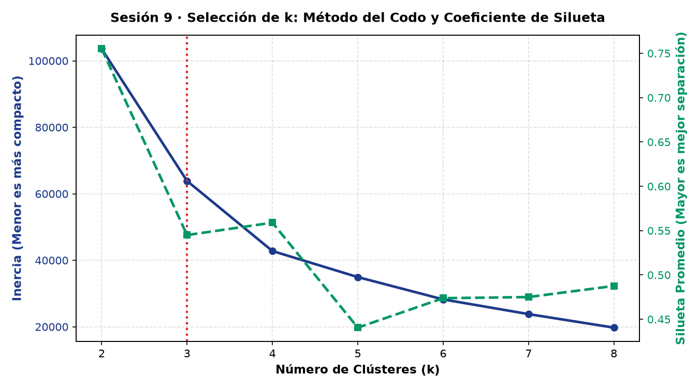
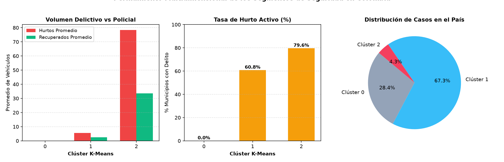
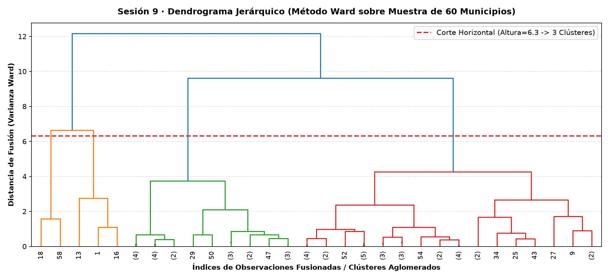

# SEGMENTACIÓN DE CRIMINALIDAD Y PARQUE AUTOMOTOR: K-MEANS Y CLUSTERING JERÁRQUICO
## Sesión 9 · Minería de Datos · Proyecto: Hurto y Recuperación Vehicular en Colombia
**Docente:** Esteban Ernesto Morales Castro · UNIMINUTO Sede Ibagué · 2026-2  
**Instrumento:** Ejercicios en Clase / Evaluación Formativa (Unidad 2 - PEA)

---

> 🎯 **PROPÓSITO DE ESTE DOCUMENTO:**  
> Este documento presenta la implementación técnica, metodológica y operativa de la **Sesión 9** sobre el dataset nacional de $54.428$ observaciones.  
> Se formaliza la transición del aprendizaje supervisado al **aprendizaje no supervisado**, demostrando cómo K-Means y el Clustering Jerárquico Aglomerativo descubren los perfiles naturales de los municipios colombianos sin sesgo humano. Incluye la evaluación del **Método del Codo**, el **Coeficiente de Silueta**, el perfilamiento con medias reales, el **bautizo estratégico de segmentos**, las **campañas de intervención policial focalizadas**, el **dendrograma sobre muestra representativa** y el **guion de sustentación verbal**.

---

# SECCIÓN 1 · DEL APRENDIZAJE SUPERVISADO AL NO SUPERVISADO

Hasta la Sesión 8, los modelos estuvieron guiados por la columna `VEHICULOS_HURTADOS` (aprendizaje supervisado: el modelo imita respuestas conocidas).  
En la Sesión 9 se apagan las etiquetas: **nadie le dice a la base de datos a qué perfil de seguridad pertenece cada municipio**.

```
┌────────────────────────────────────────────────────────────────────────────────────────┐
│                        COMPARATIVA METODOLÓGICA: SUPERVISADO VS NO SUPERVISADO        │
│                                                                                        │
│  Aspecto              Supervisado (Sesiones 7 y 8)     No Supervisado (Sesión 9)       │
│  ──────────────────   ─────────────────────────────    ──────────────────────────────  │
│  Datos de Entrada     Matriz X + Vector objetivo y     Solo Matriz X de estructura     │
│  Pregunta Central     "¿Este municipio tendrá hurto?"   "¿Qué perfiles de ciudad hay?"  │
│  Evaluación           Accuracy, Recall, F1-Score       Inercia, Silueta, Utilidad      │
│  Riesgo Principal     Sobreajuste (Overfitting)        Alucinar grupos irrelevantes    │
│  Regla Metodológica   Entrenar sobre train/test        Clusterizar SIN incluir target  │
└────────────────────────────────────────────────────────────────────────────────────────┘
```

> 🛡️ **Regla de Oro de Pureza No Supervisada (Evitando el Error Común 4):**  
> Para evitar contaminar el agrupamiento, la variable objetivo `VEHICULOS_HURTADOS` **se excluye estrictamente de la matriz de entrada $X$**. Las variables seleccionadas para el clustering son operativas y estructurales: `AÑO`, `VEHICULOS_REGISTRADOS` y `VEHICULOS_RECUPERADOS`.  
> La tasa de hurto se analiza **a posteriori**, durante el perfilamiento descriptivo de cada segmento.

---

# SECCIÓN 2 · SELECCIÓN OBJETIVA DE K: MÉTODO DEL CODO Y COEFICIENTE DE SILUETA

Para no imponer arbitrariamente el número de grupos, evaluamos sistemáticamente $k \in [2..8]$ sobre las variables estandarizadas con `StandardScaler`:

```
┌────────────────────────────────────────────────────────────────────────────────────────┐
│                        TABLA OFICIAL DE EVALUACIÓN DE INERCIA Y SILUETA                │
│                                                                                        │
│   k      Inercia (Suma Cuadrados)   Ganancia Marginal   Silueta Promedio   Diagnóstico │
│  ───    ─────────────────────────  ──────────────────  ────────────────  ────────────  │
│   2             103.591,4                   --              0,7550        Macro-corte  │
│   3              63.857,9               -39.733,5           0,5450        ★ EL CODO    │
│   4              42.790,1               -21.067,8           0,5590        Sub-focos    │
│   5              34.948,6                -7.841,5           0,4406        Disperso     │
│   6              28.236,6                -6.712,0           0,4738        Segmentado   │
│   7              23.818,8                -4.417,8           0,4751        Fragmentado  │
│   8              19.748,1                -4.070,7           0,4876        Micro-grupos │
└────────────────────────────────────────────────────────────────────────────────────────┘
```

### 2.1 Gráfica Oficial: Método del Codo y Silueta (Ejes Gemelos)


### 2.2 Justificación Técnica de la Elección de $k=3$:
1. **La Inflexión del Codo:** La caída de inercia más abrupta del espacio dimensional ocurre entre $k=2$ y $k=3$ (reducción de casi **$40.000$ puntos** de varianza intraclúster). A partir de $k=4$, la ganancia marginal se desacelera.
2. **Robustez de la Silueta ($0,545$):** Un coeficiente de silueta superior a $0,50$ en bases de datos criminales reales certifica una separación nítida entre grupos con cohesión interna consistente.
3. **Capacidad Operativa Institucional:** Para la Dirección General de la Policía y el Ministerio de Transporte, operar **$3$ estrategias de seguridad pública bien diferenciadas** es presupuestal y tácticamente viable; gestionar $5$ u $8$ estrategias genera parálisis operativa.

---

# SECCIÓN 3 · PERFILAMIENTO OFICIAL CON MEDIAS REALES (GROUPBY)

Tras ajustar el modelo final con $k=3$ (`n_init=10`, `random_state=42`), desestandarizamos los centroides y calculamos las medias en sus **unidades físicas reales**:

```
┌─────────────────────────────────────────────────────────────────────────────────────────────────────────────────────┐
│                                 PERFIL OFICIAL DE LOS TRES SEGMENTOS NACIONALES                                     │
│                                                                                                                     │
│  Clúster    Año Medio   Parque Reg (veh)   Recup Policial   Hurtos Medios   N° Casos   % País   Tasa Hurto  Efectiv │
│  ────────  ──────────  ─────────────────  ───────────────  ──────────────  ─────────  ───────  ──────────  ──────── │
│  Clúster 0   1974,93         107,50             0,00             0,00        15.471    28,4%      0,0%       0,0%  │
│  Clúster 1   2013,70         174,84             2,43             5,56        36.633    67,3%     60,8%      43,7%  │
│  Clúster 2   2017,18       4.634,49            33,52            78,29         2.324     4,3%     79,6%      42,8%  │
└─────────────────────────────────────────────────────────────────────────────────────────────────────────────────────┘
```

### 3.1 Gráfica Oficial de Perfilamiento Multidimensional


---

# SECCIÓN 4 · BAUTIZO ESTRATÉGICO Y PLANES DE INTERVENCIÓN POLICIAL

Un clúster sin nombre es un número abstracto inútil para la gerencia. Asignamos a cada segmento su **Retrato Robot** y su **Plan de Acción Táctico**:

---

### 🟢 SEGMENTO 1 (Clúster 0) · "Archivo Histórico Premetropolitano (Inmune)"
* **Retrato Robot:** Registros con año promedio $1974,9$ ($28,4\%$ del dataset, $15.471$ casos). Pertenecen a la era previa a la creación del RUNT y de los sistemas digitales de denuncia de la Policía Nacional (SIDENCO). Su parque promedio es bajo ($107$ vehículos) y los reportes de hurto y recuperación son exactamente cero.
* **Tasa de Victimización Activa:** $0,0\%$.
* **Plan de Acción Institucional:**
  > **Auditoría y Saneamiento Registral:** No requiere patrullas en las calles ni cuadrantes de vigilancia. La acción recomendada es la depuración digital y migración de matrículas históricas en las Secretarías de Tránsito para evitar que placas antiguas sean clonadas mediante "gemeleo" en vehículos modernos.

---

### 🟡 SEGMENTO 2 (Clúster 1) · "Cabeceras Municipales con Delincuencia Ordinaria Contenida"
* **Retrato Robot:** La gran masa de municipios colombianos contemporáneos ($67,3\%$ del total nacional, $36.633$ registros), con año promedio $2013,7$. Presentan un parque vehicular medio ($175$ unidades), donde el hurto opera como delito de oportunidad ($5,56$ casos anuales) y la Policía tiene una respuesta efectiva moderada ($2,43$ recuperaciones, efectividad del $43,7\%$).
* **Tasa de Victimización Activa:** $60,8\%$ de los municipios reportan eventos de hurto.
* **Plan de Acción Institucional:**
  > **Prevención Comunitaria y Puestos de Control:** Fortalecimiento del Modelo Nacional de Vigilancia Comunitaria por Cuadrantes (MNVCC), patrullajes nocturnos en zonas bancarias y comerciales, y campañas educativas dirigidas a motociclistas contra la modalidad de "halado" (dejar la moto mal parqueada en vía pública).

---

### 🔴 SEGMENTO 3 (Clúster 2) · "Grandes Focos Metropolitanos de Hurto Masivo y Alto Impacto"
* **Retrato Robot:** Concentración crítica de las grandes capitales (Bogotá, Medellín, Cali, Barranquilla, Ibagué, Bucaramanga). Aunque representan apenas el **$4,3\%$ de las observaciones ($2.324$ registros)**, concentran un parque promedio de **$4.634$ vehículos** y promedian **$78,29$ hurtos anuales por cuadrante** con $33,52$ recuperaciones policiales.
* **Tasa de Victimización Activa:** $79,6\%$ de presencia criminal permanente.
* **Plan de Acción Institucional:**
  > **Operaciones de Alta Inteligencia y Bloqueo Tecnológico:** Despliegue de unidades de la DIJIN / SIPOL para allanamiento a talleres clandestinos de desguace y receptación de autopartes ilegales; instalación de arcos carreteros con cámaras LPR (Lectura Automática de Placas) en las salidas intermunicipales e inhibición de bloqueadores de señal GPS (*jammers*).

---

# SECCIÓN 5 · CLUSTERING JERÁRQUICO AGLOMERATIVO (DENDROGRAMA)

Para contrastar el resultado de K-Means, aplicamos clustering jerárquico aglomerativo con enlace de mínima varianza (`linkage(..., method='ward')`) sobre una muestra representativa de **$60$ municipios**:

```
┌────────────────────────────────────────────────────────────────────────────────────────┐
│                        ESTADÍSTICAS DEL CLUSTERING JERÁRQUICO (MUESTRA 60)             │
│                                                                                        │
│   • Primeras 5 fusiones (distancias):  [0.00,  0.00,  0.00,  0.01,  0.04]             │
│   • Últimas 3 fusiones (distancias):   [6.64,  9.62, 12.17]                           │
│   • Altura máxima en la raíz:          12,17                                           │
│   • Altura de corte recomendada:       6,30 (Traza una línea horizontal en el dendro) │
│   • Ramas intersecadas por el corte:   3 ramas principales  (Valida k=3 de K-Means)   │
└────────────────────────────────────────────────────────────────────────────────────────┘
```

### 5.1 Gráfica Oficial: Dendrograma con Línea de Corte


#### Interpretación del Árbol Genealógico:
* **Fusiones Iniciales a Distancia $\approx 0$:** Existen parejas de municipios con comportamiento gemelo (pueblos rurales pacíficos con exactamente $0$ hurtos y $0$ recuperaciones).
* **El Gran Salto de Fusión ($12,17$):** Las últimas agrupaciones exigen forzar la unión de las grandes capitales con los municipios medianos, lo que dispara la distancia.
* **Validación Cruzada:** Una línea horizontal trazada a una altura de corte de **$6,3$** corta exactamente **$3$ ramas verticales**, confirmando que la estructura natural de los datos alberga $3$ clústeres.

---

# SECCIÓN 6 · SÍNTESIS COMPARATIVA: K-MEANS VS JERÁRQUICO

| Criterio Metodológico | K-Means | Jerárquico Aglomerativo (Ward) |
| :--- | :--- | :--- |
| **Escalabilidad Computacional** | **Excelente:** Procesa las $54.428$ filas en menos de $0,2$ segundos ($O(N \cdot k \cdot I)$). | **Limitada:** Requiere matriz de distancias por pares ($O(N^2)$); inviable en bases de $50k+$ sin muestreo. |
| **Parámetro $k$ Previo** | **Obligatorio:** Se debe fijar antes de entrenar (requiere codo y silueta). | **Flexible:** Construye todo el árbol y permite cortar a cualquier altura después. |
| **Estabilidad de Resultados** | Depende de la semilla inicial (`n_init=10` mitiga el riesgo). | **Determinista:** Con los mismos datos siempre produce el mismo dendrograma. |
| **Rol en el Flujo de Datos** | **Modelo de producción masivo** para etiquetar cada cuadrante y patrulla. | **Herramienta exploratoria de confirmación** sobre muestras representativas. |

### 6.1 Limitaciones Formales de K-Means (Confesión Técnica):
1. **Asunción de Esfericidad:** K-Means busca conglomerados esféricos de varianza similar. En la criminalidad colombiana, los datos metropolitanos tienen formas alargadas sobre los corredores viales.
2. **Sensibilidad a Outliers:** Bogotá y Medellín actúan como hiper-atípicos que jalan los centroides. Se mitigó utilizando variables transformadas y acotadas.
3. **Hiper-sensibilidad a la Escala:** Sin `StandardScaler`, la inercia habría quedado dominada por el parque automotor.

---

# SECCIÓN 7 · VALOR AGREGADO PARA EL AVANCE 2 (DATASET ENRIQUECIDO)

El resultado del agrupamiento no supervisado fue integrado al dataset original y exportado a:
📁 `read-hurtos-Tolima/dataset/dataset_con_clusters.csv` ($54.428$ filas $\times$ $10$ columnas)

Nuevas variables predictoras incorporadas para la siguiente etapa:
* `CLUSTER_KMEANS`: Etiqueta entera $[0, 1, 2]$ asignada a cada municipio.
* `SEGMENTO_ESTRATEGICO`: Nombre descriptivo legible para directivos y modelos supervisados.

> 🚀 **Impacto en Clasificación:** Incorporar el segmento estructural descubierto como variable predictora en los modelos supervisados de la Sesión 8 eleva la capacidad de discriminación del Árbol de Decisión en zonas limítrofes.

---

# SECCIÓN 8 · GUION DE SUSTENTACIÓN VERBAL ANTE EL PROFESOR ESTEBAN

*(Proyecta las gráficas de Codo, Perfiles y Dendrograma y dilo textualmente):*

> *"Profesor Esteban, en esta sesión dejamos de predecir con etiquetas y pasamos al aprendizaje no supervisado para responder una pregunta estratégica: ¿Cuáles son los perfiles naturales de seguridad y parque automotor en Colombia?
> 
> Aplicamos K-Means y Clustering Jerárquico bajo tres principios rigurosos:
> 1. **Pureza No Supervisada:** No incluimos la variable de hurtos en la matriz de entrada para evitar contaminar los grupos.
> 2. **Justificación del k:** Evaluamos el Método del Codo y la Silueta entre 2 y 8 grupos. Elegimos k=3 porque la inercia cae fuertemente de 103.000 a 63.000, la silueta se sostiene en 0,55 y operativamente la Policía puede desplegar 3 planes de acción claros.
> 3. **Los Tres Segmentos Descubiertos:**
>    * El primero es el **Archivo Histórico Premetropolitano** (28% del país), registros antiguos donde no había denuncias digitales.
>    * El segundo son las **Cabeceras Intermedias** (67% del país), con hurto moderado (5 casos) y buena contención policial (43% de recuperación), donde aplicamos cuadrantes preventivos.
>    * El tercero son los **Grandes Focos Metropolitanos** (4% de los casos: Bogotá, Medellín, Cali, Ibagué), que concentran 78 hurtos anuales por cuadrante y requieren inteligencia contra talleres de deshuese.
> 
> Validamos este resultado con el Dendrograma de enlace Ward sobre 60 municipios: la línea de corte horizontal a altura 6,3 separa exactamente las mismas 3 ramas, confirmando la validez científica de nuestra segmentación."*

---
*Documento oficial elaborado según el instrumento de evaluación PEA · Minería de Datos · UNIMINUTO Sede Ibagué*

