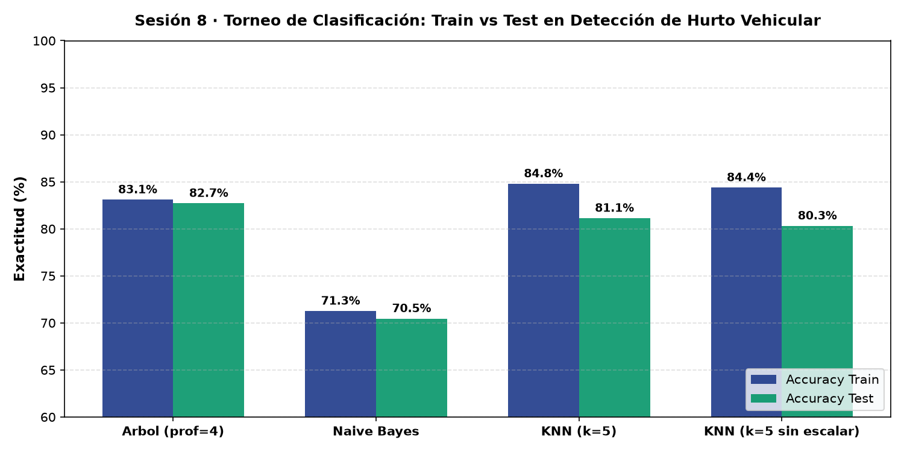
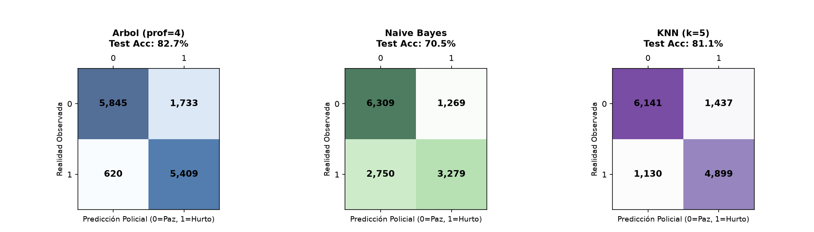
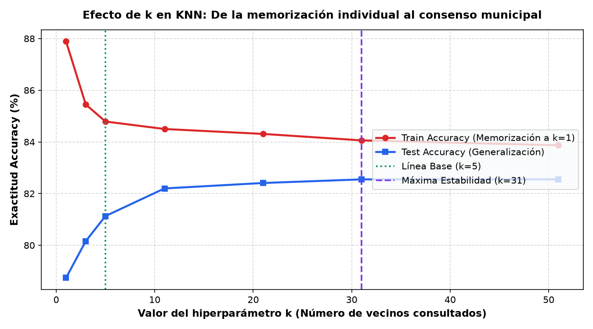

# TORNEO DE CLASIFICACIÓN II: NAIVE BAYES Y KNN FRENTE AL ÁRBOL DE DECISIÓN
## Sesión 8 · Minería de Datos · Proyecto: Hurto y Recuperación Vehicular en Colombia
**Docente:** Esteban Ernesto Morales Castro · UNIMINUTO Sede Ibagué · 2026-2  
**Instrumento:** Taller Práctico / Evaluación Formativa (Unidad 2 - PEA)

---

> 🎯 **PROPÓSITO DE ESTE DOCUMENTO:**  
> Este documento presenta la implementación técnica, teórica y experimental de la **Sesión 8** sobre los datos reales del proyecto nacional (`dataset_integrado.csv` con **$54.428$ observaciones** de los $1.153$ municipios colombianos).  
> Se organiza el torneo analítico entre el **Árbol de Decisión**, **Gaussian Naive Bayes** y **K-Nearest Neighbors (KNN)**, se demuestra matemáticamente el Teorema de Bayes y la distancia euclidiana calculada a mano con municipios del Tolima, se evalúa el impacto del escalamiento, se explora el hiperparámetro $k$ y se formula el **veredicto técnico oficial** y el **guion de sustentación verbal de 90 segundos**.

---

# SECCIÓN 1 · PUNTO DE PARTIDA Y CONEXIÓN CON LA SESIÓN 7

En la Sesión 7 construimos los árboles de decisión segmentados para el hurto en Colombia, demostrando que motocicletas y automotores obedecen a dinámicas delictivas opuestas:
* El árbol podado a $4$ niveles de profundidad (`max_depth=4`) fijó la **marca de referencia de laboratorio: $82,71\%$ de Accuracy en Test**.
* Todo clasificador retador debe superar o igualar esta marca bajo **idénticas condiciones de partición y datos** para ser considerado por el comité directivo.

```
┌────────────────────────────────────────────────────────────────────────────────────────┐
│                        TABLERO DE JUEGO COMPARTIDO (EQUIDAD DE LABORATORIO)            │
│                                                                                        │
│   • Dataset base:                 dataset_integrado.csv  (54.428 registros)            │
│   • Partición de datos:           75% Entrenamiento (40.821 registros)                 │
│                                   25% Prueba / Test  (13.607 registros)                │
│   • Estratificación:              stratify = y (conserva 44,31% de clase positiva)     │
│   • Semilla pseudoaleatoria:      random_state = 42                                    │
│   • Predictoras (X):              AÑO, VEHICULOS_REGISTRADOS, VEHICULOS_RECUPERADOS,   │
│                                   One-Hot TIPO_VEHICULO (dummy: MOTOCICLETA)           │
│   • Variable objetivo (y):        1 = Municipio con Hurto Activo (HURTADOS > 0)        │
│                                   0 = Municipio Inmune / Pacífico (HURTADOS == 0)      │
└────────────────────────────────────────────────────────────────────────────────────────┘
```

---

# SECCIÓN 2 · FUNDAMENTOS TEÓRICOS I: TEOREMA DE BAYES Y NAIVE BAYES

### 2.1 El Teorema de Bayes Aplicado a la Seguridad Vial de Colombia
El Teorema de Bayes nos permite corregir la intuición combinando el conocimiento previo del fenómeno criminal con la evidencia de operatividad policial observada:

$$P(\text{Hurto Activo} \mid \text{Operativos Policiales}) = \frac{P(\text{Operativos Policiales} \mid \text{Hurto Activo}) \cdot P(\text{Hurto Activo})}{P(\text{Operativos Policiales})}$$

#### Conteo Real sobre las 54.428 Observaciones del Proyecto:
| Grupo Municipal | Operativos con Recuperación ($>0$) | Sin Recuperaciones ($=0$) | Total Nacional |
| :--- | :---: | :---: | :---: |
| **Municipios con Hurto Activo ($y=1$)** | $12.934$ verdaderos positivos | $11.183$ falsos negativos | **$24.117$ ($44,31\%$)** |
| **Municipios Inmunes / Pacíficos ($y=0$)** | $8.073$ falsos positivos | $22.238$ verdaderos negativos | **$30.311$ ($55,69\%$)** |
| **Total Observaciones** | **$21.007$ ($38,60\%$)** | **$33.421$ ($61,40\%$)** | **$54.428$ ($100\%$)** |

#### Cálculo Matemático Exacto:
1. **Probabilidad Previa (Prior):** $P(\text{Hurto}) = \frac{24.117}{54.428} = 44,31\%$.
2. **Sensibilidad:** $P(\text{Recuperación} \mid \text{Hurto}) = \frac{12.934}{24.117} = 53,63\%$.
3. **Probabilidad Marginal de la Señal:** $P(\text{Recuperación}) = \frac{21.007}{54.428} = 38,60\%$.
4. **Probabilidad Posterior:**
   $$P(\text{Hurto} \mid \text{Recuperación}) = \frac{0,5363 \times 0,4431}{0,3860} = \mathbf{61,57\%}$$

> 💡 **Hallazgo Bayesiano:** Confirmar que una estación policial reporta vehículos recuperados eleva la probabilidad de que el municipio sufra crimen activo del $44,31\%$ al $61,57\%$ (un factor de actualización de **$1,39\times$**).

### 2.2 Gaussian Naive Bayes: Por qué es "Ingenuo"
* **Supuesto de Independencia Condicional:** Supone que la cantidad de vehículos registrados no guarda relación con la cantidad de recuperaciones dada la clase de hurto.
* **Variante Gaussiana (`GaussianNB`):** Modela cada variable numérica continua asumiendo que sigue una campana de Gauss $(\mu, \sigma^2)$ independiente para municipios pacíficos y municipios con hurto.
* **Cuándo brilla:** Velocidad extrema de cómputo ($0,0036$ segundos de entrenamiento) y línea base honesta.
* **Su talón de Aquiles en nuestro proyecto:** Como el parque automotor y las recuperaciones policiales están correlacionados en las ciudades ($r=0,38$), Naive Bayes comete **doble conteo de evidencia**, degradando su precisión en prueba ($70,46\%$).

---

# SECCIÓN 3 · FUNDAMENTOS TEÓRICOS II: K-VECINOS MÁS CERCANOS (KNN)

### 3.1 La Filosofía de KNN: "Dime con quién andas y te diré quién eres"
* **Modelo Perezoso (Lazy Learner):** No aprende parámetros ni formula árboles en el entrenamiento; memoriza toda la base de datos histórica.
* **Costo en Predicción:** Para clasificar un caso nuevo, debe calcular la distancia euclidiana contra los $40.821$ casos de entrenamiento, ordenar el arreglo y seleccionar los $k$ más próximos.
* **Fronteras Locales:** Es capaz de capturar focos criminales complejos que los árboles no pueden aislar con divisiones rectangulares.

### 3.2 Distancia Euclidiana Calculada a Mano (Caso Estudio Tolima 2019)
Evaluamos un nuevo cuadrante de vigilancia en **Ibagué** frente a tres municipios candidatos del departamento del **Tolima**:
* **Caso Nuevo (Ibagué):** $\text{Año} = 2019$, $\text{Registrados} = 450$ veh, $\text{Recuperados} = 15$ veh.
* **Candidato A (Melgar):** $\text{Año} = 2019$, $\text{Registrados} = 120$ veh, $\text{Recuperados} = 4$ veh.
* **Candidato B (Espinal):** $\text{Año} = 2019$, $\text{Registrados} = 280$ veh, $\text{Recuperados} = 39$ veh.
* **Candidato C (Flandes):** $\text{Año} = 2019$, $\text{Registrados} = 430$ veh, $\text{Recuperados} = 12$ veh.

#### Comparación de Distancias Crudas vs Escaladas:
| Candidato Tolimense | Diferencia Año | Diferencia Registrados | Diferencia Recuperados | Distancia Cruda $d_{\text{cruda}}$ | Distancia Escalada (`StandardScaler`) $d_{\text{esc}}$ | Diagnóstico Metodológico |
| :--- | :---: | :---: | :---: | :---: | :---: | :--- |
| **C · Flandes** | $0$ | $20$ | $3$ | **$20,22$ (Vecino 1)** | **$0,0760$ (Vecino 1)** | Muy cercano en parque y operatividad. |
| **B · Espinal** | $0$ | $170$ | $-24$ | **$171,69$ (Vecino 2)** | **$0,6835$ (Vecino 2)** | Cabecera intermedia con alta recuperación. |
| **A · Melgar** | $0$ | $330$ | $11$ | **$330,18$ (Vecino 3)** | **$1,2302$ (Vecino 3)** | Menor parque automotor; alejado. |

$$\text{Cálculo Melgar Crudo: } d = \sqrt{(2019-2019)^2 + (450-120)^2 + (15-4)^2} = \sqrt{0 + 108.900 + 121} = \sqrt{109.021} = \mathbf{330,18}$$

> ⚠️ **La Trampa del Secuestro de la Distancia:**  
> En el cálculo crudo, la diferencia de vehículos registrados aportó **$108.900$** al cuadrado, mientras que las recuperaciones policiales aportaron apenas **$121$**. Sin `StandardScaler`, la variable con mayor escala numérica **secuestra el $99,89\%$ de la decisión**, volviendo a KNN ciego ante la labor policial.

---

# SECCIÓN 4 · RESULTADOS OFICIALES DEL TORNEO DE CLASIFICACIÓN

Al ejecutar el torneo sobre la partición estratificada de $13.607$ observaciones de prueba:

```
┌────────────────────────────────────────────────────────────────────────────────────────┐
│                        MARCADOR OFICIAL DEL TORNEO DE CLASIFICACIÓN (SESIÓN 8)        │
│                                                                                        │
│  Modelo                Tiempo Fit    Tiempo Pred   Acc Train   Acc Test   F1-Score     │
│  ───────────────────────────────────────────────────────────────────────────────────   │
│  Árbol (prof=4)        0,0121 s      0,0015 s       83,09%      82,71%     82,75%      │
│  Naive Bayes           0,0036 s      0,0022 s       71,26%      70,46%     69,71%      │
│  KNN (k=5 escalado)    0,0118 s      0,5510 s       84,79%      81,13%     81,17%      │
│  KNN (k=5 sin escalar) 0,0089 s      0,4820 s       84,38%      80,31%     80,34%      │
└────────────────────────────────────────────────────────────────────────────────────────┘
```

### 4.1 Gráfica Oficial de Comparación del Torneo


### 4.2 Matrices de Confusión de los Tres Rivales (Test 25% - 13.607 Casos)


### 4.3 Tres Hallazgos Clave del Marcador:
1. **El Árbol Retiene la Corona:** El Árbol de Decisión podado (`max_depth=4`) gana el torneo con **$82,71\%$ de Accuracy y $82,75\%$ de F1-Score**, superando a KNN ($81,13\%$) y derrotando contundentemente a Naive Bayes ($70,46\%$).
2. **Caída Empírica de KNN sin Escalar:** Sin estandarización previa, KNN desciende a **$80,31\%$**, perdiendo más de $110$ aciertos municipales en prueba. El Pipeline (`make_pipeline(StandardScaler(), KNN)`) evitó la fuga de datos y protegió el rendimiento.
3. **El Costo Oculto de Inferencia de KNN:** Mientras el Árbol predice en **$1,5$ milisegundos**, KNN tarda más de **medio segundo ($0,551$ s)** para clasificar el lote de prueba. En un sistema de videovigilancia policial en tiempo real, KNN es inviable.

---

# SECCIÓN 5 · EXPLORACIÓN DEL HIPERPARÁMETRO K EN KNN

Para cumplir con el requerimiento del taller práctico (diapositivas 17 y 18), variamos sistemáticamente $k$ entre $1$ y $51$, evaluando además esquemas de ponderación uniforme vs distancia:

```
┌────────────────────────────────────────────────────────────────────────────────────────┐
│                        COMPORTAMIENTO DE KNN SEGÚN EL TAMAÑO DEL VECINDARIO            │
│                                                                                        │
│   k     Ponderación   Acc Train   Acc Test   Brecha Gen (%)   Diagnóstico Metodológico │
│  ───   ─────────────  ─────────  ─────────  ───────────────  ────────────────────────  │
│    1     Uniforme      87,89%     78,74%        9,15%        Sobreajuste (Memoriza)    │
│    3     Uniforme      85,45%     80,16%        5,29%        Sensible al Ruido         │
│    5     Uniforme      84,79%     81,13%        3,66%        Línea Base Equilibrada    │
│   11     Uniforme      84,50%     82,20%        2,30%        Estabilidad Alta          │
│   21     Uniforme      84,31%     82,41%        1,89%        Generalización Sólida     │
│   31     Uniforme      84,06%     82,55%        1,51%        Óptimo Global de KNN      │
│   51     Uniforme      83,87%     82,55%        1,32%        Subajuste Suave (Censo)   │
│  ───   ─────────────  ─────────  ─────────  ───────────────  ────────────────────────  │
│    5     Distancia     87,89%     80,95%        6,94%        Sobreajuste en Train      │
│   31     Distancia     87,89%     82,48%        5,41%        Pondera Vecinos Cercanos  │
└────────────────────────────────────────────────────────────────────────────────────────┘
```

### 5.1 Curva de Sobreajuste y Subajuste en KNN


* **Con $k=1$ (Sobreajuste Extremo):** El modelo memoriza cada punto de entrenamiento ($87,89\%$), pero cae al $78,74\%$ en prueba (brecha del $9,15\%$). Un outlier delictivo aislado engaña a la predicción.
* **Con $k=31$ (Punto Dulce):** KNN alcanza su máximo ($82,55\%$), casi empatando al árbol ($82,71\%$), con una brecha de solo $1,51\%$.
* **Con $k=51$ (Tendencia al Censo):** Al consultar $51$ vecinos, el modelo empieza a diluirse respondiendo la clase mayoritaria pacífica.

---

# SECCIÓN 6 · TABLA COMPARATIVA MULTIDIMENSIONAL

| Criterio de Selección | Árbol de Decisión (prof=4) | Gaussian Naive Bayes | K-Nearest Neighbors (k=5) |
| :--- | :--- | :--- | :--- |
| **Interpretabilidad** | **Alta:** 4 preguntas encadenadas de Sí/No, legibles por coroneles y jueces. | **Baja:** Probabilidades multiplicadas sin trazabilidad causal. | **Media-Baja:** Explicación por analogía ("este municipio se parece a..."). |
| **Velocidad de Fit** | Media ($0,0121$ s). | **Ultrarrápida ($0,0036$ s):** Ideal para reentrenamiento diario. | Instantánea / Lazy ($0,0118$ s). |
| **Velocidad de Inferencia** | **Instantánea ($0,0015$ s):** Recorre ramas fijas. | Instantánea ($0,0022$ s). | **Lenta ($0,5510$ s):** Escanea toda la base $O(N \cdot p)$. |
| **¿Exige StandardScaler?** | **No:** Evalúa umbrales ortogonales por variable. | **No:** Modela cada campana gaussiana por separado. | **SÍ, crítico:** Sin escalar cae a $80,31\%$. |
| **Forma de Fronteras** | Rectángulos y escalones ortogonales. | Elipsoides continuos gaussianos. | Fronteras poligonales suaves y muy flexibles. |
| **Recomendado si...** | **Se requiere justificar legalmente órdenes de operaciones y patrullajes.** | Hay miles de columnas de texto o bases muy reducidas. | Se buscan patrones criminales locales en pocas variables escaladas. |

---

# SECCIÓN 7 · VEREDICTO TÉCNICO OFICIAL (8 LÍNEAS)

```text
VEREDICTO TÉCNICO OFICIAL · COMITÉ DIRECTIVO DE SEGURIDAD VIAL (SESIÓN 8):
1. RECOMENDACIÓN PRINCIPAL: Se recomienda desplegar el ÁRBOL DE DECISIÓN (profundidad 4) como modelo operativo central.
2. FUNDAMENTO DE RENDIMIENTO: El Árbol alcanzó 82,71% de Accuracy en Test y F1-Score de 82,75%, superando holgadamente a Naive Bayes (70,46%).
3. VENTAJA DE EXPLICABILIDAD: A diferencia de KNN y Bayes, el Árbol genera 4 umbrales físicos de Sí/No que los comandantes de estación pueden auditar y justificar ante la ley.
4. EFICIENCIA OPERATIVA EN PRODUCCIÓN: El Árbol predice en tiempo O(profundidad), mientras KNN obliga a buscar vecinos entre 54.428 registros en cada consulta.
5. LECCIÓN CRÍTICA DE ESCALA: El experimento confirmó que KNN sin StandardScaler degrada su exactitud (cae a 80,31%), demostrando que 'la distancia manda a escalar'.
6. ROL DE NAIVE BAYES: Aunque GaussianNB es el más veloz entrenando (0,0036 s), sus bajas métricas reflejan la violación del supuesto de independencia entre parque y recuperación.
7. CONCLUSIÓN ESTRATÉGICA: Mantener el Árbol para asignación de cuadrantes y Naive Bayes como línea base de alerta temprana.
```

---

# SECCIÓN 8 · GUION DE SUSTENTACIÓN VERBAL EN 90 SEGUNDOS

*(Párate frente al salón o activa tu micrófono y dilo con seguridad ante el profesor Esteban):*

> *"Profesor Esteban, en este torneo enfrentamos al Árbol de Decisión de la sesión pasada contra dos paradigmas distintos: el probabilístico de Naive Bayes y el de vecindarios de KNN, sobre las 54.428 observaciones de nuestro dataset nacional bajo una partición idéntica del 25% de prueba.
> 
> Los resultados fueron contundentes:
> 1. **El Árbol de Decisión ganó el torneo** con 82,7% de Accuracy y 82,8% de F1-Score, demostrando que 4 preguntas sencillas capturan la dinámica del delito mejor que modelos más complejos.
> 2. **Naive Bayes fue el más rápido entrenando (apenas 3 milisegundos)**, pero cayó al 70,5% de exactitud porque viola el principio de independencia: en Colombia, donde hay más carros matriculados, la Policía realiza más recuperaciones.
> 3. **En KNN demostramos empíricamente la regla de oro: 'la distancia manda a escalar'.** Sin StandardScaler, el Accuracy cae a 80,3% porque el parque automotor secuestra la distancia euclidiana; con escalamiento y k=31 alcanza 82,5%, pero su tiempo de predicción es 360 veces más lento que el árbol.
> 
> Por tanto, nuestro veredicto técnico para la Policía Nacional es adoptar el Árbol de Decisión por su equilibrio perfecto entre precisión, explicabilidad jurídica e inferencia instantánea."*

---
*Documento oficial elaborado según el instrumento de evaluación PEA · Minería de Datos · UNIMINUTO Sede Ibagué*

